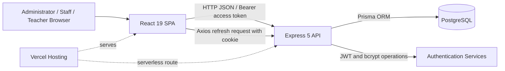
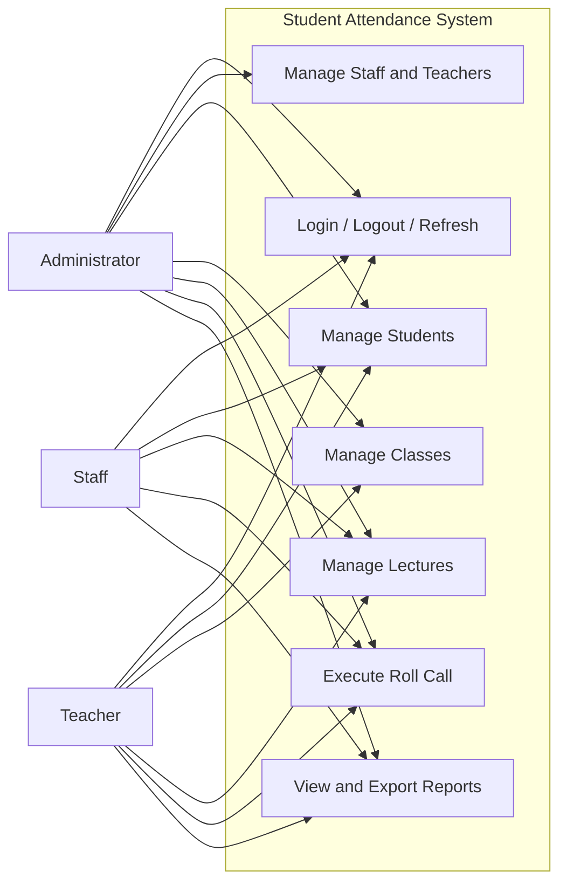
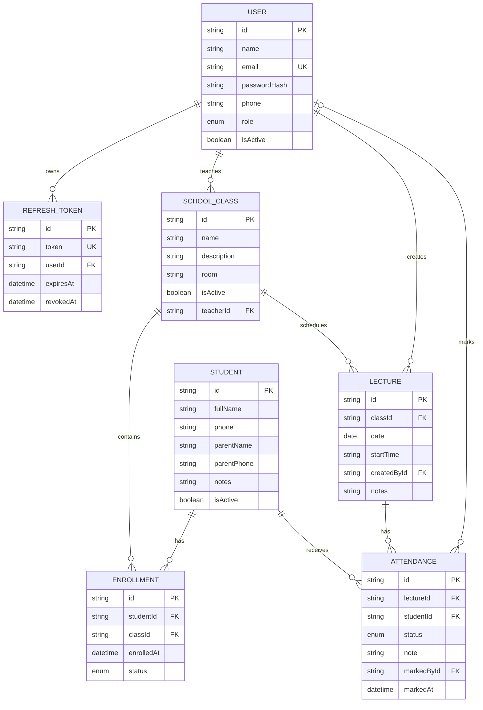
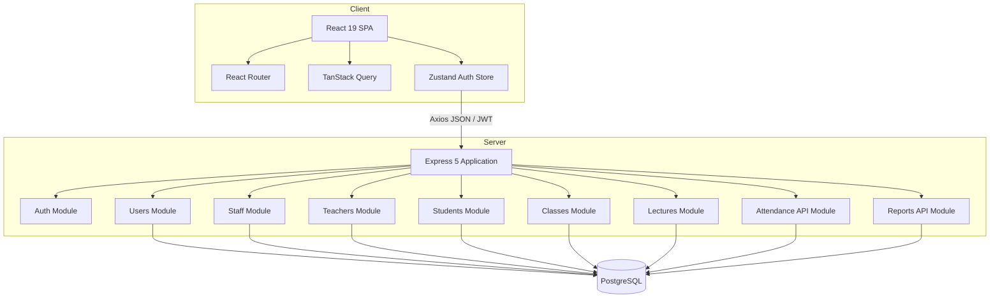
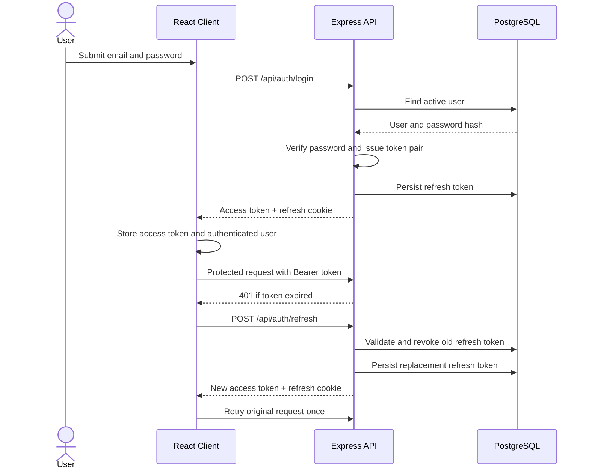
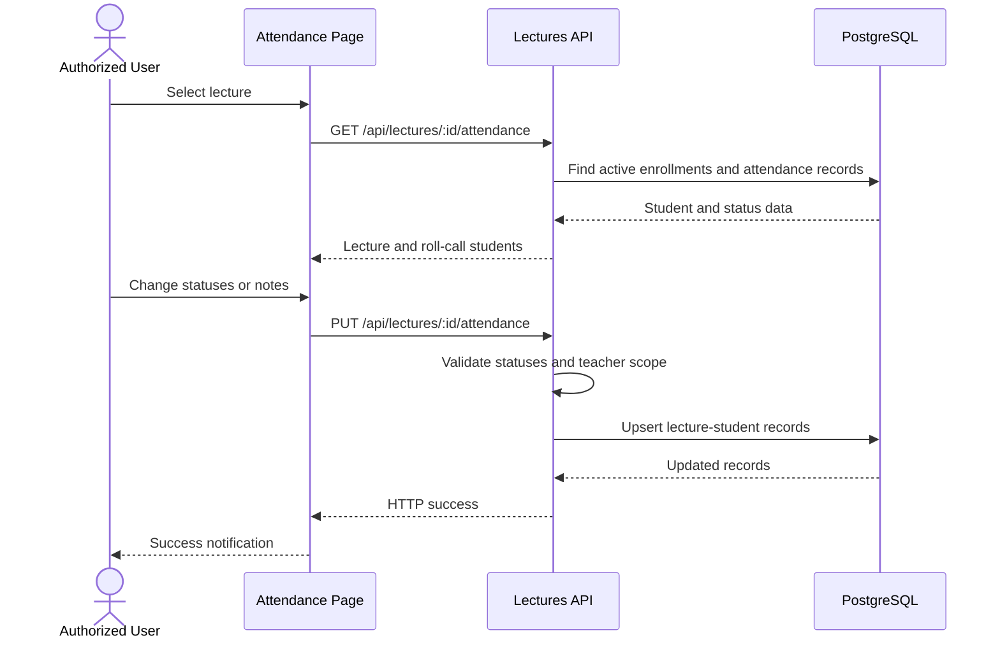

# Software Requirements Specification

## Student Attendance System

**Document ID:** SRS-ATTENDANCE-1.2\
**Standard:** ISO/IEC/IEEE 29148:2018

---

## Document Control

| Field | Value |
| --- | --- |
| Title | Student Attendance System Software Requirements Specification |
| Version | 1.2 |
| Date | 2026-11-25 |
| Author | Osama Ahmed |
| Status | Draft – as-built, pending stakeholder confirmation |
| Repository | UsamaA7med/attendance-system |
| Primary source | Repository code and database schema |

### Revision History

| Version | Date | Author | Description |
| --- | --- | --- | --- |
| 1.0 | 2026-11-25 | Copilot SDK AI Assistant | Initial as-built SRS derived from the repository snapshot |
| 1.1 | 2026-11-25 | Copilot SDK AI Assistant | Reviewed requirement atomicity and acceptance criteria; removed duplicate business-rule and data restatements |
| 1.2 | 2026-11-25 | Osama Ahmed | Aligned document ID and version; renumbered requirement IDs sequentially; removed duplicate and implementation-level requirements; moved TBD items to Appendix B; replaced traceability ranges with a per-requirement matrix |

---

## 1. Introduction

### 1.1 Purpose

This document specifies the implemented requirements of the Student Attendance System as observed in the repository. It is intended for developers, testers, operators, administrators, and project stakeholders. It describes the as-built system and does not describe planned or speculative capabilities.

Statements marked **TBD – needs confirmation** identify information that cannot be established from the source material.

### 1.2 Scope

The system is a full-stack educational-center portal for managing users, students, classes, lectures, student attendance, and attendance reporting.

The implemented scope includes:

- Administrator-controlled account provisioning.
- Login, logout, access-token validation, refresh-token rotation, and session revocation.
- Role-based access for Administrator, Staff, and Teacher users.
- Teacher and Staff management.
- Student management and class enrollment.
- Class and assigned-teacher management.
- Lecture scheduling and attendance roll call.
- Server-side filtering and pagination.
- Attendance metrics and charts.
- Client-side Excel workbook export.
- Health and API discovery endpoints.

The backend also contains legacy staff check-in and check-out endpoints, but no corresponding application route was found in the current React application. These endpoints are documented as legacy or separately implemented scope rather than a confirmed end-user feature.

### 1.3 Definitions, Acronyms, and Abbreviations

| Term | Definition |
| --- | --- |
| Admin | User with the `ADMIN` role and full administrative access in the implemented authorization matrix |
| API | Application Programming Interface |
| Attendance record | One student's status for one lecture |
| Enrollment | Association between a student and a class |
| Lecture | One scheduled class session with a date and start time |
| Refresh token | Database-persisted, rotatable token used to obtain a new access token |
| Roll call | Recording one of `PRESENT`, `ABSENT`, `LATE`, or `EXCUSED` for students |
| Staff | User with the `STAFF` role |
| Teacher | User with the `TEACHER` role |
| TBD | To be determined and requiring stakeholder confirmation |
| UI | User interface |

### 1.4 References

| Reference | Source |
| --- | --- |
| ISO/IEC/IEEE 29148:2018 | Requirements engineering standard cited for document structure and requirement quality |
| Repository README | `/README.md` |
| Backend application | `/server/src/app.ts` |
| Prisma database schema | `/server/prisma/schema.prisma` |
| Frontend routing | `/client/src/App.tsx` |
| Vercel deployment configuration | `/vercel.json` |
| Backend package manifest | `/server/package.json` |
| Frontend package manifest | `/client/package.json` |

### 1.5 Document Overview

Sections 2 and 3 describe the product, constraints, interfaces, and requirements. Section 4 provides major use cases and acceptance criteria. Section 5 provides Mermaid diagrams. Section 6 provides traceability. Appendix A contains additional glossary terms, Appendix B lists open questions, and Appendix C separates future enhancements from current requirements.

---

## 2. Overall Description

### 2.1 Product Perspective

The Student Attendance System is a decoupled web application consisting of a React 19 single-page application and an Express 5 modular-monolith API backed by PostgreSQL.

The frontend uses React Router, TanStack Query, Zustand, Axios, Tailwind CSS, and shadcn-style UI components. The backend uses TypeScript, Zod, Prisma, PostgreSQL, JWT, bcrypt, Helmet, CORS, compression, cookie parsing, and Morgan.

The API is organized as feature modules: authentication, users, teachers, staff, students, classes, lectures, attendance, and reports.

### 2.2 Product Functions

| Function | Summary |
| --- | --- |
| Authentication | Login, account provisioning, current-user lookup, token refresh, and logout |
| Staff administration | Create, read, update, activate/deactivate, search, paginate, and delete staff accounts |
| Teacher administration | Create, read, update, activate/deactivate, search, paginate, and delete teacher accounts |
| Student administration | Create, read, update, activate/deactivate, search, paginate, delete, and enroll students |
| Class management | Create, read, update, activate/deactivate, search, paginate, and delete classes |
| Lecture management | Create, read, update, search, filter, paginate, and delete lectures |
| Attendance roll call | View enrolled students and save `PRESENT`, `ABSENT`, `LATE`, or `EXCUSED` statuses |
| Reporting | Filter attendance by 7, 30, or 90 days, show charts and metrics, and export Excel |
| Navigation and authorization | Render role-specific navigation and prevent unauthorized client and API access |

### 2.3 User Classes and Characteristics

| User class | Characteristics | Primary permissions |
| --- | --- | --- |
| Administrator | Center administrator operating all management areas | Staff and teacher CRUD; all class, lecture, student, attendance, and report operations permitted by the route matrix |
| Staff | Operational employee managing students and attendance | Student CRUD and enrollment; lecture and attendance operations; report and lecture views |
| Teacher | Instructor assigned to one or more classes | Own classes and lectures only; own-student read access; class and lecture CRUD for authorized own records; roll call |

### 2.4 Operating Environment

- **Client runtime:** modern browser with JavaScript enabled. Exact supported browser versions are TBD.
- **Client development:** Vite development server on the configured client origin.
- **API runtime:** Node.js with Express 5 and TypeScript. Exact Node.js version is TBD.
- **Database:** PostgreSQL.
- **Deployment:** Vercel configuration serves the client as a SPA and exposes serverless API rewrites.
- **External systems:** none explicitly integrated. PostgreSQL is a required data dependency.
- **Network protocol:** HTTP/HTTPS with JSON request and response bodies.

### 2.5 Design and Implementation Constraints

| Constraint | Description |
| --- | --- |
| DC-001 | The client shall communicate with the API through Axios. |
| DC-002 | The API shall use Express 5 and TypeScript. |
| DC-003 | PostgreSQL shall be accessed through Prisma and the PostgreSQL adapter. |
| DC-004 | Authentication shall use JWT access and refresh tokens. |
| DC-005 | Passwords shall be stored as bcrypt hashes. |
| DC-006 | API request validation shall use Zod. |
| DC-007 | The database pool shall use a maximum of 10 connections, an idle timeout of 30 seconds, and a connection timeout of 10 seconds. |
| DC-008 | Protected API routes shall require a Bearer access token unless the route is explicitly public. |
| DC-009 | The refresh token cookie shall use the `/api/auth` path. |
| DC-010 | Deployment configuration shall support Vercel SPA and serverless API rewrites. |

### 2.6 Assumptions and Dependencies

1. A valid `DATABASE_URL` is available to the server.
2. The access-token, refresh-token, and JWT environment values are configured for the deployment.
3. Administrators provision all Staff and Teacher accounts.
4. PostgreSQL data is available and reachable during normal operation.
5. Local and production CORS origins are correctly configured.

The following are TBD:

- Production availability objective.
- Data-retention and deletion policy.
- Backup and disaster-recovery objective.
- Supported browser and Node.js versions.
- Time zone used for operational reporting.

---

## 3. Specific Requirements

### 3.1 Functional Requirements

#### 3.1.1 Authentication and Session Management

| ID | Description | Priority | Source | Acceptance Criteria |
| --- | --- | --- | --- | --- |
| FR-AUTH-001 | The system shall authenticate a user who submits an email and password that match an active account. | Must | `auth.service.ts`, `auth.schema.ts` | Valid credentials for an active account return HTTP 200 and an access token; invalid credentials or an inactive account return HTTP 401. |
| FR-AUTH-002 | The system shall reject login when the supplied email is not a syntactically valid email. | Must | `auth.schema.ts` | Invalid email input is rejected with a validation error. |
| FR-AUTH-003 | The system shall reject login when the password field is empty. | Must | `auth.schema.ts` | An empty password is rejected with a validation error. |
| FR-AUTH-004 | The system shall permit only an authenticated Administrator to register an account. | Must | `auth.routes.ts`, `staff.routes.ts` | A non-admin registration attempt returns HTTP 403; an admin registration returns HTTP 201. |
| FR-AUTH-005 | The system shall create registered accounts with the Staff role. | Must | `auth.service.ts` | A successful registration creates a user whose role is `STAFF`. |
| FR-AUTH-006 | The system shall reject registration names shorter than 2 characters. | Should | `auth.schema.ts` | The account is not created and validation errors are returned. |
| FR-AUTH-007 | The system shall reject passwords shorter than 6 characters during registration. | Must | `auth.schema.ts` | The account is not created and validation errors are returned. |
| FR-AUTH-008 | The system shall reject registration if the email is already registered. | Must | `auth.service.ts` | The account is not created and HTTP 409 is returned. |
| FR-AUTH-009 | The system shall issue an access token whose lifetime is set by `JWT_ACCESS_EXPIRES_IN` (default 15 minutes) after successful authentication. | Must | `auth.service.ts`, `env.ts` | The access token expires after the configured lifetime; when the variable is unset it expires after 15 minutes. |
| FR-AUTH-010 | The system shall issue a database-persisted refresh token after successful authentication. | Must | `auth.service.ts`, `refresh-token.repository.ts` | A refresh-token record is created and associated with the authenticated user. |
| FR-AUTH-011 | The system shall place the refresh token in an HTTP-only cookie. | Must | `auth.controller.ts` | The refresh cookie is set with HTTP-only enabled and path `/api/auth`. |
| FR-AUTH-012 | The system shall accept a refresh token from the cookie or request body. | Must | `auth.controller.ts` | A valid cookie or body token produces a refreshed access token. |
| FR-AUTH-013 | The system shall revoke a valid refresh token during refresh-token rotation. | Must | `auth.service.ts` | The old refresh token record receives a `revokedAt` timestamp before a replacement pair is returned. |
| FR-AUTH-014 | The system shall issue a replacement access token and refresh token after valid refresh-token rotation. | Must | `auth.service.ts` | The response contains a new access token and a new persisted refresh token. |
| FR-AUTH-015 | The system shall reject a revoked refresh token. | Must | `auth.service.ts` | The refresh operation returns HTTP 401 and no replacement token pair is returned. |
| FR-AUTH-016 | The system shall reject an expired refresh token. | Must | `auth.service.ts` | The refresh operation returns HTTP 401 and no replacement token pair is returned. |
| FR-AUTH-017 | The system shall reject a malformed refresh token. | Must | `auth.service.ts` | The refresh operation returns HTTP 401 and no replacement token pair is returned. |
| FR-AUTH-018 | The system shall reject a refresh token associated with an inactive user. | Must | `auth.service.ts` | The refresh operation returns HTTP 401 and no replacement token pair is returned. |
| FR-AUTH-019 | The system shall invalidate all sessions for a user when refresh-token reuse is detected more than 15 seconds after revocation. | Should | `auth.service.ts` | All refresh records for the user are revoked and HTTP 401 is returned. |
| FR-AUTH-020 | The system shall revoke the supplied refresh token during logout. | Must | `auth.controller.ts` | The supplied refresh token record is revoked or no longer valid after logout. |
| FR-AUTH-021 | The system shall clear the refresh cookie during logout. | Must | `auth.controller.ts` | The response contains a cleared refresh cookie with the `/api/auth` path. |
| FR-AUTH-022 | The system shall return the current authenticated user's profile from `/api/auth/me`. | Must | `auth.routes.ts`, `auth.controller.ts` | An authenticated request returns HTTP 200 with the current user's safe profile. |
| FR-AUTH-023 | The system shall automatically attempt refresh and retry an unauthorized non-auth API request once. | Must | `client/src/lib/api.ts` | On one 401 response, the client obtains a new access token and retries the original request once. |

#### 3.1.2 Staff Management

| ID | Description | Priority | Source | Acceptance Criteria |
| --- | --- | --- | --- | --- |
| FR-STAFF-001 | The system shall restrict Staff management endpoints to authenticated Administrators. | Must | `staff.routes.ts` | A non-admin receives HTTP 403 and cannot execute a Staff management operation. |
| FR-STAFF-002 | The system shall allow an Administrator to create a Staff account. | Must | `staff.routes.ts`, `staff.service.ts` | A valid account is created and returned with HTTP 201. |
| FR-STAFF-003 | The system shall allow an Administrator to view one Staff account by ID. | Must | `staff.routes.ts` | A valid ID returns the Staff profile; unknown IDs return HTTP 404. |
| FR-STAFF-004 | The system shall allow an Administrator to search Staff accounts by name, email, phone, department, or position. | Must | `staff.repository.ts` | A case-insensitive text match in any listed field returns the matching Staff account. |
| FR-STAFF-005 | The system shall allow an Administrator to filter Staff accounts by active state. | Must | `staff.schema.ts`, `staff.repository.ts` | `true` returns active accounts, `false` returns inactive accounts, and `all` returns both. |
| FR-STAFF-006 | The system shall support pagination for Staff account listings. | Must | `staff.routes.ts`, `staff.repository.ts` | Responses include page, limit, total, total pages, and next/previous indicators. |
| FR-STAFF-007 | The system shall allow an Administrator to update Staff account fields. | Must | `staff.routes.ts` | Submitted valid fields are persisted and the updated profile is returned. |
| FR-STAFF-008 | The system shall allow an Administrator to deactivate a Staff account. | Must | `staff.service.ts` | Setting `isActive=false` persists and subsequent login is rejected. |
| FR-STAFF-009 | The system shall allow an Administrator to reactivate a Staff account. | Must | `staff.service.ts` | Setting `isActive=true` persists and subsequent login is permitted. |
| FR-STAFF-010 | The system shall allow an Administrator to delete a Staff account. | Must | `staff.routes.ts` | A DELETE request for an existing Staff account removes the account; a protected or unknown account returns the applicable error response. |
| FR-STAFF-011 | The system shall return the total, active, and inactive Staff counts. | Should | `staff.repository.ts` | The metrics response contains three non-negative integer values that sum to the total count. |

#### 3.1.3 Teacher Management

| ID | Description | Priority | Source | Acceptance Criteria |
| --- | --- | --- | --- | --- |
| FR-TCHR-001 | The system shall restrict Teacher management endpoints to authenticated Administrators. | Must | `teachers.routes.ts` | A non-admin receives HTTP 403 and cannot execute a Teacher management operation. |
| FR-TCHR-002 | The system shall allow an Administrator to create a Teacher account. | Must | `teachers.routes.ts`, `teachers.service.ts` | A valid account is created and returned with HTTP 201. |
| FR-TCHR-003 | The system shall allow an Administrator to search Teacher accounts by name, email, phone, or department. | Must | `teachers.repository.ts` | A case-insensitive text match in any listed field returns the matching Teacher account. |
| FR-TCHR-004 | The system shall allow an Administrator to filter Teacher accounts by active state. | Must | `teachers.schema.ts`, `teachers.repository.ts` | `true` returns active accounts, `false` returns inactive accounts, and `all` returns both. |
| FR-TCHR-005 | The system shall allow an Administrator to paginate Teacher accounts. | Must | `teachers.repository.ts` | The requested page contains no more than the requested limit and includes pagination metadata. |
| FR-TCHR-006 | The system shall allow an Administrator to update Teacher account fields. | Must | `teachers.routes.ts` | Valid changes persist and the updated profile is returned. |
| FR-TCHR-007 | The system shall allow an Administrator to deactivate a Teacher account. | Must | `teachers.service.ts` | Setting `isActive=false` persists and subsequent login is rejected. |
| FR-TCHR-008 | The system shall allow an Administrator to reactivate a Teacher account. | Must | `teachers.service.ts` | Setting `isActive=true` persists and subsequent login is permitted. |
| FR-TCHR-009 | The system shall allow an Administrator to delete a Teacher account. | Must | `teachers.routes.ts`, `teachers.service.ts` | A DELETE request removes an existing Teacher account when no referential constraint prevents deletion. |
| FR-TCHR-010 | The system shall return the total Teacher count, active Teacher count, and active-class assignment count. | Should | `teachers.repository.ts` | The metrics response contains those three database-derived counts. |

#### 3.1.4 Student Management and Enrollment

| ID | Description | Priority | Source | Acceptance Criteria |
| --- | --- | --- | --- | --- |
| FR-STU-001 | The system shall allow authenticated Administrators and Staff to create students. | Must | `students.routes.ts`, `students.service.ts` | Valid student data creates a student and returns HTTP 201. |
| FR-STU-002 | The system shall allow authenticated Administrators, Staff, and Teachers to view the Student directory. | Must | `students.routes.ts` | Authorized users receive the permitted student list. |
| FR-STU-003 | The system shall restrict a Teacher's student list to students with an `ACTIVE` enrollment in a class assigned to that Teacher. | Must | `students.service.ts`, `students.repository.ts` | Every returned student has at least one matching `ACTIVE` enrollment for the Teacher's user ID. |
| FR-STU-004 | The system shall reject a new student full name shorter than 2 characters or longer than 100 characters. | Must | `students.schema.ts` | The student is not created and validation errors are returned. |
| FR-STU-005 | The system shall require a parent name for a new student. | Must | `students.schema.ts` | A missing or too-short parent name prevents creation. |
| FR-STU-006 | The system shall require a parent phone of 8 to 20 characters. | Must | `students.schema.ts` | A missing, shorter-than-8-character, or longer-than-20-character parent phone prevents creation or update. |
| FR-STU-007 | The system shall accept an optional student phone containing only digits and the characters `+`, `(`, `)`, space, and `-`. | Must | `students.schema.ts` | Valid optional phones are stored; disallowed characters are rejected. |
| FR-STU-008 | The system shall limit student notes to 500 characters. | Should | `students.schema.ts` | Notes longer than 500 characters are rejected. |
| FR-STU-009 | The system shall search students by full name, parent name, student phone, or parent phone. | Should | `students.repository.ts` | A case-insensitive match in full name or parent name and a contains match in either phone field return matching records. |
| FR-STU-010 | The system shall support active-state filtering for Student listings. | Must | `students.repository.ts`, `students.schema.ts` | `isActive=true` returns only active students and `isActive=false` returns only inactive students. |
| FR-STU-011 | The system shall paginate Student listings. | Must | `students.repository.ts`, `students.schema.ts` | A requested page contains at most the requested limit and the response includes page, limit, total, and totalPages. |
| FR-STU-012 | The system shall allow Administrators and Staff to update a student. | Must | `students.routes.ts` | Valid updates persist and the updated student is returned. |
| FR-STU-013 | The system shall allow Administrators and Staff to delete a student. | Must | `students.routes.ts`, `students.service.ts` | A valid student is deleted unless protected by an implemented referential constraint. |
| FR-STU-014 | The system shall allow Administrators and Staff to enroll a student in an active class. | Must | `students.service.ts` | A successful enrollment creates or restores an active enrollment in the selected class. |
| FR-STU-015 | The system shall prevent enrollment in a class that is not active. | Must | `students.service.ts` | The enrollment is rejected with a bad-request error. |
| FR-STU-016 | The system shall initialize a default `PRESENT` attendance record for UTC-date lectures when a student is enrolled. | Should | `students.service.ts` | A lecture in the selected class whose stored date equals the current UTC date receives one `PRESENT` record for the student. |
| FR-STU-017 | The system shall return total, active, inactive, and active-enrollment counts for students. | Should | `students.repository.ts` | An Administrator or Staff response uses all students; a Teacher response excludes students outside that Teacher's active class enrollments. |

#### 3.1.5 Class Management

| ID | Description | Priority | Source | Acceptance Criteria |
| --- | --- | --- | --- | --- |
| FR-CLS-001 | The system shall allow authenticated Administrators and Teachers to create classes. | Must | `classes.routes.ts`, `classes.service.ts` | A valid class is created; non-authorized Staff receive HTTP 403. |
| FR-CLS-002 | The system shall assign a Teacher-created class to the authenticated Teacher. | Must | `classes.service.ts` | The created class's `teacherId` equals the authenticated Teacher ID. |
| FR-CLS-003 | The system shall require an Administrator to specify a teacher when creating a class. | Must | `classes.service.ts` | Missing teacher ID for an Administrator returns HTTP 400. |
| FR-CLS-004 | The system shall reject assignment of a class to an inactive Teacher. | Must | `classes.service.ts` | The class is not created or reassigned and a bad-request error is returned. |
| FR-CLS-005 | The system shall allow an authenticated Administrator or Staff member to view class records. | Must | `classes.routes.ts` | An authenticated Administrator or Staff member receives HTTP 200 for an authorized class-list or class-detail request. |
| FR-CLS-006 | The system shall allow an authenticated Teacher to view only assigned class records. | Must | `classes.routes.ts`, `classes.service.ts` | A Teacher receives HTTP 200 only for classes whose `teacherId` equals the Teacher's user ID. |
| FR-CLS-007 | The system shall restrict a Teacher's class list to classes assigned to that Teacher. | Must | `classes.service.ts`, `classes.repository.ts` | The Teacher's class response excludes classes assigned to other teachers. |
| FR-CLS-008 | The system shall allow an Administrator to update class teacher assignment. | Must | `classes.service.ts` | A valid active Teacher ID replaces the existing assignment. |
| FR-CLS-009 | The system shall prevent a Teacher from assigning a class to a different Teacher. | Must | `classes.service.ts` | The update is rejected with HTTP 403. |
| FR-CLS-010 | The system shall allow Administrators and assigned Teachers to update classes. | Must | `classes.service.ts` | Valid authorized updates persist and return the updated class. |
| FR-CLS-011 | The system shall allow Administrators and assigned Teachers to delete classes. | Must | `classes.service.ts` | Authorized deletion succeeds; unrelated Teacher deletion returns HTTP 403. |
| FR-CLS-012 | The system shall search classes by name, description, room, or teacher name. | Should | `classes.repository.ts` | A case-insensitive text match in any listed field returns the matching class. |
| FR-CLS-013 | The system shall filter classes by Teacher ID and active state. | Should | `classes.schema.ts`, `classes.repository.ts` | A supplied Teacher ID and state filter are each applied to the returned list. |
| FR-CLS-014 | The system shall paginate class listings. | Should | `classes.schema.ts`, `classes.repository.ts` | A requested page contains at most the requested limit and includes pagination metadata. |
| FR-CLS-015 | The system shall limit class names to 2 to 100 characters. | Must | `classes.schema.ts` | Out-of-range names are rejected. |
| FR-CLS-016 | The system shall limit room names to 50 characters. | Should | `classes.schema.ts` | Room names longer than 50 characters are rejected. |
| FR-CLS-017 | The system shall return total classes, active classes, total lectures, and active enrollments. | Should | `classes.repository.ts` | A Teacher response counts only classes and lectures assigned to that Teacher and active enrollments in those classes. |

#### 3.1.6 Lecture Management

| ID | Description | Priority | Source | Acceptance Criteria |
| --- | --- | --- | --- | --- |
| FR-LCT-001 | The system shall allow an authenticated Administrator or Staff member to view lectures. | Must | `lectures.routes.ts` | An authenticated Administrator or Staff member receives lecture records authorized by the submitted filters. |
| FR-LCT-002 | The system shall restrict a Teacher's lecture list to lectures belonging to that Teacher's classes. | Must | `lectures.service.ts`, `lectures.repository.ts` | A Teacher receives no lecture for a class assigned to another Teacher. |
| FR-LCT-003 | The system shall allow an Administrator or Staff member to create a lecture for an existing class. | Must | `lectures.routes.ts`, `lectures.service.ts` | A valid lecture is created and `createdById` equals the authenticated user's ID. |
| FR-LCT-004 | The system shall allow an assigned Teacher to create a lecture for an existing class. | Must | `lectures.routes.ts`, `lectures.service.ts` | A lecture is created only when `class.teacherId` equals the authenticated Teacher's ID. |
| FR-LCT-005 | The system shall reject lecture creation for a class to which the Teacher is not assigned. | Must | `lectures.service.ts` | HTTP 403 is returned and no lecture is created. |
| FR-LCT-006 | The system shall accept lecture dates only in `YYYY-MM-DD` format. | Must | `lectures.schema.ts` | Invalid date strings are rejected by validation. |
| FR-LCT-007 | The system shall accept lecture start times only in 24-hour `HH:mm` format. | Must | `lectures.schema.ts` | Values outside `00:00` to `23:59` format are rejected. |
| FR-LCT-008 | The system shall prevent duplicate lectures with the same class, date, and start time. | Must | `lectures.service.ts`, Prisma unique key | A duplicate create or update is rejected with HTTP 409. |
| FR-LCT-009 | The system shall initialize a default `PRESENT` attendance record for every active student enrolled in a class when a lecture is created. | Must | `lectures.service.ts` | One attendance record with `PRESENT` status exists for each active enrolled student after lecture creation. |
| FR-LCT-010 | The system shall allow an authorized user to update a lecture date. | Must | `lectures.routes.ts`, `lectures.service.ts` | A valid date persists and a Teacher cannot update a lecture outside assigned classes. |
| FR-LCT-011 | The system shall allow an authorized user to update a lecture start time. | Must | `lectures.routes.ts`, `lectures.service.ts` | A valid `HH:mm` start time persists unless it conflicts with another lecture in the same class and date. |
| FR-LCT-012 | The system shall allow an authorized user to update lecture notes. | Must | `lectures.routes.ts`, `lectures.service.ts` | Submitted notes persist or are stored as null when the notes field is null. |
| FR-LCT-013 | The system shall allow an authorized Administrator or Staff member to delete a lecture. | Must | `lectures.routes.ts`, `lectures.service.ts` | The lecture and its attendance records are removed after an authenticated authorized delete request. |
| FR-LCT-014 | The system shall allow an assigned Teacher to delete a lecture. | Must | `lectures.routes.ts`, `lectures.service.ts` | The Teacher can delete only a lecture whose class has `teacherId` equal to the Teacher's user ID. |
| FR-LCT-015 | The system shall filter lectures by class ID, exact date, start date, end date, or text search. | Should | `lectures.repository.ts` | Each supplied filter is applied; text search matches class name, room, or lecture notes. |
| FR-LCT-016 | The system shall paginate lecture listings. | Should | `lectures.repository.ts`, `lectures.schema.ts` | A requested page contains at most the requested limit and includes pagination metadata. |

#### 3.1.7 Attendance Roll Call

| ID | Description | Priority | Source | Acceptance Criteria |
| --- | --- | --- | --- | --- |
| FR-ATT-001 | The system shall allow an Administrator or Staff member to view the active enrolled students for a lecture. | Must | `lectures.service.ts`, `lectures.routes.ts` | The roll call contains every student whose enrollment status is `ACTIVE` for the lecture's class. |
| FR-ATT-002 | The system shall allow an assigned Teacher to view active enrolled students for a lecture. | Must | `lectures.service.ts`, `lectures.routes.ts` | The roll call contains matching active enrollments only when `class.teacherId` equals the Teacher's user ID. |
| FR-ATT-003 | The system shall allow a roll call status of `PRESENT`, `ABSENT`, `LATE`, or `EXCUSED`. | Must | `lectures.schema.ts`, Prisma enum | The API accepts only those four values. |
| FR-ATT-004 | The system shall allow authorized users to create or update an individual attendance record by lecture and student. | Must | `lectures.service.ts` | One record exists after save and repeated saves update the same record rather than creating duplicates. |
| FR-ATT-005 | The system shall record the marker user and marked timestamp when roll call is saved. | Must | `lectures.service.ts`, Prisma schema | `markedById` equals the authenticated user and `markedAt` is set to save time. |
| FR-ATT-006 | The system shall display a virtual `PRESENT` status for an enrolled student without a saved attendance record. | Should | `lectures.service.ts` | An unsaved enrolled student is presented with `PRESENT` until another status is explicitly saved. |
| FR-ATT-007 | The system shall accept an optional text note for an attendance record. | Could | `lectures.schema.ts` | A submitted string is stored in `Attendance.note`; a null or omitted note is stored as null. |
| FR-ATT-008 | The system shall prevent a Teacher from saving attendance for a lecture outside their assigned classes. | Must | `lectures.service.ts` | HTTP 403 is returned and no records are changed. |
| FR-ATT-009 | The system shall provide an Attendance page that combines lecture selection, date filtering, class filtering, and roll call execution. | Must | `client/src/pages/Attendance.tsx`, `DashboardLayout.tsx` | The page provides these controls to authorized roles and opens roll call for a selected lecture. |

#### 3.1.8 Reports and Export

| ID | Description | Priority | Source | Acceptance Criteria |
| --- | --- | --- | --- | --- |
| FR-RPT-001 | The system shall allow Administrators, Staff, and Teachers to open the current Reports UI route. | Should | `DashboardLayout.tsx`, `App.tsx` | The Reports route renders without role routing blocking any listed role. |
| FR-RPT-002 | The system shall provide a report for the 7 calendar days ending on the current date. | Must | `client/src/pages/Reports.tsx` | Selection of 7 days sets the inclusive start date to the current date minus 6 days. |
| FR-RPT-003 | The system shall provide a report for the 30 calendar days ending on the current date. | Must | `client/src/pages/Reports.tsx` | Selection of 30 days sets the inclusive start date to the current date minus 29 days. |
| FR-RPT-004 | The system shall provide a report for the 90 calendar days ending on the current date. | Must | `client/src/pages/Reports.tsx` | Selection of 90 days sets the inclusive start date to the current date minus 89 days. |
| FR-RPT-005 | The system shall calculate the attendance rate as present records divided by all status records, rounded to a whole percentage. | Must | `Reports.tsx` | A population of 2 present and 1 absent yields 67% when JavaScript rounding is applied. |
| FR-RPT-006 | The system shall display attendance status counts for PRESENT, ABSENT, LATE, and EXCUSED. | Must | `Reports.tsx` | The report sums each status across lectures in the selected range. |
| FR-RPT-007 | The system shall display the number of lectures returned in the selected date range. | Should | `Reports.tsx` | The lecture metric equals `lectures.length`. |
| FR-RPT-008 | The system shall display the number of classes with at least one attendance record in the selected range. | Should | `Reports.tsx` | The class metric equals the number of distinct classes represented by returned lecture attendance totals. |
| FR-RPT-009 | The system shall display a daily stacked attendance trend. | Should | `Reports.tsx` | The chart contains one point per calendar date in the selected range and each status count equals the matching lecture totals. |
| FR-RPT-010 | The system shall display per-class attendance percentages. | Should | `Reports.tsx` | The chart contains at most 8 sorted class entries whose percentage equals present records divided by all status records for that class. |
| FR-RPT-011 | The system shall export the report to an Excel-compatible `.xlsx` workbook. | Must | `reports-export.ts`, `Reports.tsx` | A valid export downloads an `.xlsx` file containing Summary, Daily Attendance, Status Breakdown, and Class Attendance sheets. |
| FR-RPT-012 | The system shall disable report export while report data is loading or loading has failed. | Should | `Reports.tsx` | The export button is disabled in loading and error states. |

#### 3.1.9 Navigation and System Access

| ID | Description | Priority | Source | Acceptance Criteria |
| --- | --- | --- | --- | --- |
| FR-NAV-001 | The system shall redirect unauthenticated users to `/login`. | Must | `ProtectedRoute.tsx`, `App.tsx` | An unauthenticated request to a protected route resolves to `/login`. |
| FR-NAV-002 | The system shall redirect authenticated Teachers to `/classes` for the root route. | Must | `App.tsx`, `DashboardLayout.tsx` | A Teacher opening `/` reaches `/classes`. |
| FR-NAV-003 | The system shall redirect authenticated non-Teacher users to `/attendance` for the root route. | Must | `App.tsx` | An authenticated Admin or Staff opening `/` reaches `/attendance`. |
| FR-NAV-004 | The system shall prevent navigation to `/login` or `/register` by an authenticated user. | Should | `ProtectedRoute.tsx` | Authenticated access resolves to `/`. |
| FR-NAV-005 | The system shall expose `/register` as a redirect to `/login`. | Must | `App.tsx` | Direct access to `/register` resolves to `/login`. |
| FR-NAV-006 | The system shall display Attendance and Reports to Administrators, Staff, and Teachers. | Must | `DashboardLayout.tsx` | All three roles see both navigation links. |
| FR-NAV-007 | The system shall display Staff-only management access to Administrators. | Must | `DashboardLayout.tsx` | The Staff and Teachers links are present for Administrators and absent for Staff and Teachers. |
| FR-NAV-008 | The system shall display Classes only to Administrators and Teachers. | Must | `DashboardLayout.tsx` | The Classes link is present for Administrators and Teachers and absent for Staff. |
| FR-NAV-009 | The system shall display Students to Administrators, Staff, and Teachers. | Must | `DashboardLayout.tsx` | The Students link is present for all three roles. |
| FR-NAV-010 | The system shall display Lectures to Administrators, Staff, and Teachers. | Must | `DashboardLayout.tsx` | The Lectures link is present for all three roles. |

### 3.2 External Interface Requirements

#### 3.2.1 User Interface

| ID | Description | Priority | Source | Acceptance Criteria |
| --- | --- | --- | --- | --- |
| FR-UI-001 | The system shall provide desktop navigation as a fixed left sidebar. | Should | `DashboardLayout.tsx` | Viewports at or above the Tailwind `md` breakpoint display the fixed sidebar. |
| FR-UI-002 | The system shall provide mobile navigation as a slide-in sidebar drawer. | Should | `DashboardLayout.tsx` | Viewports below `md` display a menu control and optional drawer. |
| FR-UI-003 | The system shall display directory loading skeletons while directory data is loading. | Could | page components | Loading directory data replaces data rows with the implemented skeleton placeholders. |
| FR-UI-004 | The system shall display report loading skeletons while report data is loading. | Could | `Reports.tsx` | Loading report data replaces metric and chart values with the implemented skeleton placeholders. |
| FR-UI-005 | The system shall show a success notification after a successful operation. | Should | Sonner usage across pages | A successful create, update, delete, save, or export operation displays a Sonner success toast. |
| FR-UI-006 | The system shall show an error notification after a failed operation. | Should | Sonner usage across pages | A failed operation displays a Sonner error toast containing the implemented friendly fallback or API message. |
| FR-UI-007 | The system shall provide confirmation before destructive delete operations. | Must | `ConfirmDeleteModal.tsx`, page components | Clicking delete opens confirmation and does not delete until confirmation is accepted. |

#### 3.2.2 Hardware Interface

No dedicated hardware interface is implemented. The system requires only a network-capable client device and a browser. Details of minimum screen resolution and hardware are TBD.

#### 3.2.3 Software and API Interface

| ID | Description | Priority | Source | Acceptance Criteria |
| --- | --- | --- | --- | --- |
| FR-IF-001 | The system shall expose JSON API responses with `success`, `message`, `timestamp`, and either `data` or `errors`. | Must | `api-response.ts` | Successful and error bodies follow the implemented envelope. |
| FR-IF-002 | The system shall include pagination metadata for paginated API responses. | Must | `api-response.ts`, feature repositories | Paginated bodies include page, limit, total, totalPages, hasNextPage, and hasPrevPage. |
| FR-IF-003 | The system shall return HTTP 400 for Zod validation failures. | Must | validation middleware and error handler | Invalid schema input is not passed to a controller and returns HTTP 400. |
| FR-IF-004 | The system shall return HTTP 400 for implemented bad-business-input failures. | Must | feature services | The request is not persisted and a bad-request error is returned. |
| FR-IF-005 | The system shall return HTTP 401 for missing or invalid access tokens. | Must | `authenticate.ts` | Protected endpoints reject missing, malformed, or expired tokens with 401. |
| FR-IF-006 | The system shall return HTTP 403 for authenticated users lacking the required role or resource scope. | Must | `authenticate.ts`, feature services | Insufficient role or scope returns 403. |
| FR-IF-007 | The system shall return HTTP 404 for an unknown entity ID. | Should | feature services | A valid ID lookup that finds no entity returns HTTP 404. |
| FR-IF-008 | The system shall return HTTP 404 for an unmatched API route. | Should | not-found middleware | An unmatched `/api/*` route returns HTTP 404. |
| FR-IF-009 | The system shall return HTTP 409 for an implemented duplicate or conflict. | Should | feature services and Prisma unique constraints | A duplicate registered email or lecture slot returns HTTP 409 and creates no additional record. |

#### 3.2.4 Communication Interface

| ID | Description | Priority | Source | Acceptance Criteria |
| --- | --- | --- | --- | --- |
| NFR-COM-001 | The client shall use JSON over HTTP for API communication. | Must | `client/src/lib/api.ts`, Express setup | API calls serialize JSON request bodies and consume JSON responses. |
| NFR-COM-002 | The client shall time out an API request after 10,000 milliseconds. | Must | `client/src/lib/api.ts` | A request that has not completed within 10 seconds is rejected by Axios. |
| NFR-COM-003 | The API shall accept cross-origin requests only from the configured client origins and Vercel preview origins. | Must | `server/src/app.ts` | Requests from allowed origins complete with credentials; requests from other origins are rejected outside development. |

### 3.3 Non-Functional Requirements

#### 3.3.1 Performance

No measurable response-time or throughput targets are defined in the repository (see OQ-004). The timeout and connection-pool limits that do exist are recorded as NFR-COM-002 and constraint DC-007.

#### 3.3.2 Security

| ID | Description | Priority | Source | Acceptance Criteria |
| --- | --- | --- | --- | --- |
| NFR-SEC-001 | The system shall hash passwords with bcrypt before persistence. | Must | `auth.service.ts`, seed script | Stored password fields contain bcrypt hashes and not plaintext passwords. |
| NFR-SEC-002 | The system shall sign access tokens with `JWT_ACCESS_SECRET`. | Must | `auth.service.ts` | Access tokens verify only with the configured access secret. |
| NFR-SEC-003 | The system shall sign refresh tokens with `JWT_REFRESH_SECRET`. | Must | `auth.service.ts` | Refresh tokens verify only with the configured refresh secret. |
| NFR-SEC-004 | The system shall store refresh tokens in the database and track revocation. | Must | `RefreshToken` model | A refresh-token record contains expiry and optional revocation time. |
| NFR-SEC-005 | The system shall mark refresh cookies secure in production. | Must | `auth.controller.ts` | A production cookie configuration sets `secure: true`. |
| NFR-SEC-006 | The system shall mark refresh cookies secure when SameSite is `none`. | Must | `auth.controller.ts` | A cookie with `sameSite=none` sets `secure: true`. |
| NFR-SEC-007 | The system shall apply Helmet security headers. | Should | `server/src/app.ts` | Express responses pass through Helmet middleware. |

*Note:* Token validation and role-based rejection are specified in FR-IF-005 and FR-IF-006; the HTTP-only refresh cookie in FR-AUTH-011; CORS in NFR-COM-003; the registration restriction in FR-AUTH-004 and FR-NAV-005. Password-complexity and account-lockout policies are not defined (OQ-009).

#### 3.3.3 Reliability

| ID | Description | Priority | Source | Acceptance Criteria |
| --- | --- | --- | --- | --- |
| NFR-REL-001 | The system shall return an implemented global error envelope for unhandled application errors. | Must | `error-handler.ts`, `api-response.ts` | Unhandled requests receive an HTTP error response containing `success: false`, message, and timestamp. |
| NFR-REL-002 | The system shall clear local authentication state after refresh failure. | Must | `client/src/lib/api.ts`, `useAuthStore.ts` | The access token is removed and the auth expired event is dispatched after refresh failure. |

*Note:* Unmatched API routes return HTTP 404 per FR-IF-008. Recovery-time and recovery-point objectives are not defined (OQ-006).

#### 3.3.4 Availability

| ID | Description | Priority | Source | Acceptance Criteria |
| --- | --- | --- | --- | --- |
| NFR-AVL-001 | The system shall expose a health endpoint that reports healthy status, uptime, and timestamp. | Should | `server/src/app.ts` | `/health` returns HTTP 200 JSON while the API process is healthy. |

*Note:* The uptime target and hosting regions are not defined (OQ-005, OQ-017).

#### 3.3.5 Usability

| ID | Description | Priority | Source | Acceptance Criteria |
| --- | --- | --- | --- | --- |
| NFR-USA-001 | The system shall provide a loading indicator during application loading and mutations where implemented. | Could | `GlobalLoadingIndicator.tsx` | Loading state is reflected while active query or mutation indicators are present. |

*Note:* Desktop and mobile layouts are specified in FR-UI-001 and FR-UI-002; the report range selector in FR-RPT-002 to FR-RPT-006. No accessibility standard is defined (OQ-012).

#### 3.3.6 Maintainability

| ID | Description | Priority | Source | Acceptance Criteria |
| --- | --- | --- | --- | --- |
| NFR-MNT-001 | The backend shall place each feature in its own module containing route, controller, service, repository, schema, and type files. | Should | `server/src/modules` | An implementation review finds the listed files under the feature directory or confirms that a named file is not present in the feature architecture. |
| NFR-MNT-002 | The backend shall exit with status 0 for `npm run typecheck --workspace=server`. | Must | `server/package.json` | The command produces no TypeScript diagnostics in the validated environment. |
| NFR-MNT-003 | The root build shall exit with status 0 after building the server and client workspaces. | Must | root `package.json` | `npm run build` creates backend and frontend build output without build-script errors. |

*Note:* No automated-test coverage target is defined (OQ-016).

#### 3.3.7 Portability

| ID | Description | Priority | Source | Acceptance Criteria |
| --- | --- | --- | --- | --- |
| NFR-POR-001 | The server shall obtain database and runtime configuration from environment variables. | Must | `env.ts`, Prisma database module | Runtime starts only with the required deployment variables or documented defaults. |
| NFR-POR-002 | The client shall obtain its API base URL from `VITE_API_URL` or an environment-specific default. | Must | `client/src/lib/api.ts` | Production uses `/api`; development uses `http://localhost:5000/api` unless `VITE_API_URL` is set. |

*Note:* Portability to hosting platforms other than Vercel is not defined (OQ-023).

#### 3.3.8 Scalability

| ID | Description | Priority | Source | Acceptance Criteria |
| --- | --- | --- | --- | --- |
| NFR-SCL-001 | The system shall accept pagination limits from 1 through 100 for paginated Student, Teacher, Staff, Class, and Lecture endpoints. | Should | feature query schemas | A limit within the range is processed; a limit above 100 is rejected by validation. |

*Note:* No concurrent-user target is defined (OQ-022). The 100-record page limit also applies to lecture listings.

#### 3.3.9 Compliance and Legal

No compliance or legal requirements are defined in the repository. Applicable privacy regulations, audit-record retention, and guardian consent are open questions (OQ-011, OQ-007, OQ-021).

### 3.4 Data Requirements

#### 3.4.1 Core Entities

| Entity | Key attributes | Relationships |
| --- | --- | --- |
| User | id, name, email, passwordHash, phone, role, department, position, isActive, timestamps | Taught classes; created lectures; marked attendance; refresh tokens |
| RefreshToken | id, token, userId, expiresAt, revokedAt, createdAt | Belongs to User; cascade deleted with User |
| Student | id, fullName, phone, parentName, parentPhone, notes, isActive, enrollmentDate, timestamps | Enrollments and attendance records |
| Class | id, name, description, room, isActive, teacherId, timestamps | Belongs to User teacher; lectures and enrollments |
| Enrollment | id, studentId, classId, enrolledAt, status, timestamps | Belongs to Student and Class; unique per student-class pair |
| Lecture | id, classId, date, startTime, createdById, notes, timestamps | Belongs to Class and creator; attendance records |
| Attendance | id, lectureId, studentId, status, note, markedById, markedAt, timestamps | Belongs to Lecture and Student; optional marker User |

#### 3.4.2 Data Constraints

| ID | Description | Priority | Source | Acceptance Criteria |
| --- | --- | --- | --- | --- |
| FR-DATA-001 | The system shall enforce unique student enrollment for each student-class pair. | Must | Prisma `Enrollment` unique key | A second enrollment operation for the same student and class updates the existing record to `ACTIVE` instead of inserting a second record. |
| FR-DATA-002 | The system shall cascade delete lectures when their class is deleted. | Must | Prisma schema | Deleting a class removes all lectures whose `classId` equals the deleted class ID. |
| FR-DATA-003 | The system shall cascade delete attendance records when their lecture is deleted. | Must | Prisma schema | Deleting a lecture removes all attendance records whose `lectureId` equals the deleted lecture ID. |
| FR-DATA-004 | The system shall cascade delete enrollments when their Student or Class is deleted. | Must | Prisma schema | Deleting a Student or Class removes each Enrollment whose foreign key references the deleted record. |
| FR-DATA-005 | The system shall restrict deletion of a referenced Class Teacher or attendance Student. | Must | Prisma schema | Deleting an assigned Teacher or enrolled Student is rejected while a class or attendance reference exists. |
| FR-DATA-006 | The system shall set an attendance record's `markedById` to null when the marked-by User is deleted. | Must | Prisma schema | The attendance record remains and `markedById` is null after deletion of the User. |

*Note:* Retention periods and backup/restore procedures are not defined (OQ-007, OQ-020).

### 3.5 Business Rules

| ID | Description | Priority | Source | Acceptance Criteria |
| --- | --- | --- | --- | --- |
| BR-001 | The system shall recognize exactly one of `ADMIN`, `STAFF`, or `TEACHER` as a system role. | Must | Prisma `Role` enum | Unsupported roles are not accepted by the database model. |
| BR-002 | The system shall recognize exactly one of `PRESENT`, `ABSENT`, `LATE`, or `EXCUSED` for attendance status. | Must | Prisma `AttendanceStatus` enum | Unsupported values are rejected. |
| BR-003 | The system shall recognize exactly `ACTIVE` or `DROPPED` for an enrollment status. | Must | Prisma `EnrollmentStatus` enum | Unsupported values are rejected. |
| BR-004 | The system shall treat a class with `isActive=false` as unavailable for student enrollment. | Must | `students.service.ts` | Enrollment returns bad request for an inactive class. |
| BR-005 | The system shall treat an inactive Teacher as unavailable for class assignment. | Must | `classes.service.ts` | Assignment to an inactive Teacher is rejected. |

---

## 4. Use Cases and Acceptance Criteria

### UC-AUTH-01 Authenticate

- **Actor:** Administrator, Staff, or Teacher
- **Precondition:** An active account exists.
- **Main flow:** Actor opens `/login`; submits valid email and password; system verifies credentials; system creates a token pair and redirects the actor by role.
- **Acceptance criteria:** Valid credentials set the access token and authenticated user state; inactive or invalid credentials show an authentication error; Teacher opens `/classes`, while non-Teacher opens `/attendance`.

### UC-AUTH-02 Refresh Session

- **Actor:** Authenticated user
- **Precondition:** Access token has expired and refresh cookie or body token is present.
- **Main flow:** Client receives 401; client calls refresh once; server rotates the refresh token; client retries the original request.
- **Acceptance criteria:** The first unauthorized request is retried once after successful refresh; refresh failure clears tokens and redirects to login.

### UC-AUTH-03 Logout

- **Actor:** Authenticated user
- **Precondition:** User is signed in.
- **Main flow:** User selects Sign Out; system revokes refresh state and clears local auth state.
- **Acceptance criteria:** The refresh cookie is cleared, local user and token are cleared, query cache is cleared, and the UI reaches `/login`.

### UC-USER-01 Provision Staff or Teacher

- **Actor:** Administrator
- **Precondition:** Administrator is authenticated.
- **Main flow:** Administrator opens Staff or Teachers; submits name, email, password, and optional account fields; system validates and creates the account.
- **Acceptance criteria:** Missing or invalid required fields prevent creation; duplicate email returns HTTP 409; only an authenticated Administrator can perform the operation.

### UC-STU-01 Create and Enroll Student

- **Actor:** Administrator or Staff
- **Precondition:** Actor is authenticated and an active class exists when class enrollment is requested.
- **Main flow:** Actor opens Students; submits student fields and optional class; system creates the student and active enrollment if selected.
- **Acceptance criteria:** Names, parent details, and phone formats that violate the implemented schemas prevent creation; inactive class enrollment returns HTTP 400; UTC-date lectures receive one default record for the student.

### UC-STU-02 View Scoped Student Directory

- **Actor:** Administrator, Staff, or Teacher
- **Precondition:** Actor is authenticated.
- **Main flow:** Actor opens Students; optionally searches and filters; system returns the permitted records.
- **Acceptance criteria:** A Teacher receives only students with an `ACTIVE` enrollment in a class assigned to that Teacher; Staff and Administrator receive the repository list allowed by their route authorization.

### UC-CLS-01 Create or Assign Class

- **Actor:** Administrator or Teacher
- **Precondition:** Actor is authenticated and Teacher exists and is active.
- **Main flow:** Administrator selects an active Teacher or Teacher creates a self-assigned class; system persists the class.
- **Acceptance criteria:** Teacher-created class is assigned to that Teacher; inactive or missing Administrator assignment is rejected.

### UC-LCT-01 Schedule Lecture

- **Actor:** Administrator, Staff, or Teacher
- **Precondition:** Actor is authenticated and class exists.
- **Main flow:** Actor selects class, date, and start time; system validates format and uniqueness; system creates lecture and attendance records.
- **Acceptance criteria:** Invalid format or duplicate class-date-time is rejected; active enrolled students receive `PRESENT` records; Teacher cannot schedule in another Teacher's class.

### UC-ATT-01 Execute Roll Call

- **Actor:** Administrator, Staff, or Teacher
- **Precondition:** A lecture exists and active enrollments exist.
- **Main flow:** Actor selects lecture and opens roll call; changes statuses or notes; saves.
- **Acceptance criteria:** Only four statuses are accepted; one record per lecture-student pair is created or updated; marker and timestamp are recorded.

### UC-RPT-01 Review and Export Attendance

- **Actor:** Administrator, Staff, or Teacher
- **Precondition:** Actor is authenticated and lecture attendance data exists.
- **Main flow:** Actor selects 7, 30, or 90 days; reviews metrics and charts; chooses Export Excel.
- **Acceptance criteria:** Metrics and charts reflect the selected range; export creates `.xlsx` with the four implemented sheets; export is disabled during load or error.

---

## 5. Diagrams

### 5.1 Use Case Diagram

### 5.2 Entity Relationship Diagram

Note: `SCHOOL_CLASS` in the diagram corresponds to the `CLASS` entity used elsewhere in this document. The diagram uses a different name because `CLASS` is a reserved word in Mermaid.

### 5.3 System Context and Architecture

### 5.4 Authentication and Refresh Sequence

### 5.5 Roll Call Flow

---

## 6. Requirements Traceability Matrix

Status reflects the repository review. No automated test suite was found, so test cases are not yet defined (see OQ-016). Each requirement lists its source file(s) so it can be traced back to the implementation.

| Requirement ID | Section | Source | Test Case | Status |
| --- | --- | --- | --- | --- |
| FR-AUTH-001 | 3.1.1 Authentication and Session Management | `auth.service.ts`, `auth.schema.ts` | Not yet defined | Implemented (per repository review) |
| FR-AUTH-002 | 3.1.1 Authentication and Session Management | `auth.schema.ts` | Not yet defined | Implemented (per repository review) |
| FR-AUTH-003 | 3.1.1 Authentication and Session Management | `auth.schema.ts` | Not yet defined | Implemented (per repository review) |
| FR-AUTH-004 | 3.1.1 Authentication and Session Management | `auth.routes.ts`, `staff.routes.ts` | Not yet defined | Implemented (per repository review) |
| FR-AUTH-005 | 3.1.1 Authentication and Session Management | `auth.service.ts` | Not yet defined | Implemented (per repository review) |
| FR-AUTH-006 | 3.1.1 Authentication and Session Management | `auth.schema.ts` | Not yet defined | Implemented (per repository review) |
| FR-AUTH-007 | 3.1.1 Authentication and Session Management | `auth.schema.ts` | Not yet defined | Implemented (per repository review) |
| FR-AUTH-008 | 3.1.1 Authentication and Session Management | `auth.service.ts` | Not yet defined | Implemented (per repository review) |
| FR-AUTH-009 | 3.1.1 Authentication and Session Management | `auth.service.ts`, `env.ts` | Not yet defined | Implemented (per repository review) |
| FR-AUTH-010 | 3.1.1 Authentication and Session Management | `auth.service.ts`, `refresh-token.repository.ts` | Not yet defined | Implemented (per repository review) |
| FR-AUTH-011 | 3.1.1 Authentication and Session Management | `auth.controller.ts` | Not yet defined | Implemented (per repository review) |
| FR-AUTH-012 | 3.1.1 Authentication and Session Management | `auth.controller.ts` | Not yet defined | Implemented (per repository review) |
| FR-AUTH-013 | 3.1.1 Authentication and Session Management | `auth.service.ts` | Not yet defined | Implemented (per repository review) |
| FR-AUTH-014 | 3.1.1 Authentication and Session Management | `auth.service.ts` | Not yet defined | Implemented (per repository review) |
| FR-AUTH-015 | 3.1.1 Authentication and Session Management | `auth.service.ts` | Not yet defined | Implemented (per repository review) |
| FR-AUTH-016 | 3.1.1 Authentication and Session Management | `auth.service.ts` | Not yet defined | Implemented (per repository review) |
| FR-AUTH-017 | 3.1.1 Authentication and Session Management | `auth.service.ts` | Not yet defined | Implemented (per repository review) |
| FR-AUTH-018 | 3.1.1 Authentication and Session Management | `auth.service.ts` | Not yet defined | Implemented (per repository review) |
| FR-AUTH-019 | 3.1.1 Authentication and Session Management | `auth.service.ts` | Not yet defined | Implemented (per repository review) |
| FR-AUTH-020 | 3.1.1 Authentication and Session Management | `auth.controller.ts` | Not yet defined | Implemented (per repository review) |
| FR-AUTH-021 | 3.1.1 Authentication and Session Management | `auth.controller.ts` | Not yet defined | Implemented (per repository review) |
| FR-AUTH-022 | 3.1.1 Authentication and Session Management | `auth.routes.ts`, `auth.controller.ts` | Not yet defined | Implemented (per repository review) |
| FR-AUTH-023 | 3.1.1 Authentication and Session Management | `client/src/lib/api.ts` | Not yet defined | Implemented (per repository review) |
| FR-STAFF-001 | 3.1.2 Staff Management | `staff.routes.ts` | Not yet defined | Implemented (per repository review) |
| FR-STAFF-002 | 3.1.2 Staff Management | `staff.routes.ts`, `staff.service.ts` | Not yet defined | Implemented (per repository review) |
| FR-STAFF-003 | 3.1.2 Staff Management | `staff.routes.ts` | Not yet defined | Implemented (per repository review) |
| FR-STAFF-004 | 3.1.2 Staff Management | `staff.repository.ts` | Not yet defined | Implemented (per repository review) |
| FR-STAFF-005 | 3.1.2 Staff Management | `staff.schema.ts`, `staff.repository.ts` | Not yet defined | Implemented (per repository review) |
| FR-STAFF-006 | 3.1.2 Staff Management | `staff.routes.ts`, `staff.repository.ts` | Not yet defined | Implemented (per repository review) |
| FR-STAFF-007 | 3.1.2 Staff Management | `staff.routes.ts` | Not yet defined | Implemented (per repository review) |
| FR-STAFF-008 | 3.1.2 Staff Management | `staff.service.ts` | Not yet defined | Implemented (per repository review) |
| FR-STAFF-009 | 3.1.2 Staff Management | `staff.service.ts` | Not yet defined | Implemented (per repository review) |
| FR-STAFF-010 | 3.1.2 Staff Management | `staff.routes.ts` | Not yet defined | Implemented (per repository review) |
| FR-STAFF-011 | 3.1.2 Staff Management | `staff.repository.ts` | Not yet defined | Implemented (per repository review) |
| FR-TCHR-001 | 3.1.3 Teacher Management | `teachers.routes.ts` | Not yet defined | Implemented (per repository review) |
| FR-TCHR-002 | 3.1.3 Teacher Management | `teachers.routes.ts`, `teachers.service.ts` | Not yet defined | Implemented (per repository review) |
| FR-TCHR-003 | 3.1.3 Teacher Management | `teachers.repository.ts` | Not yet defined | Implemented (per repository review) |
| FR-TCHR-004 | 3.1.3 Teacher Management | `teachers.schema.ts`, `teachers.repository.ts` | Not yet defined | Implemented (per repository review) |
| FR-TCHR-005 | 3.1.3 Teacher Management | `teachers.repository.ts` | Not yet defined | Implemented (per repository review) |
| FR-TCHR-006 | 3.1.3 Teacher Management | `teachers.routes.ts` | Not yet defined | Implemented (per repository review) |
| FR-TCHR-007 | 3.1.3 Teacher Management | `teachers.service.ts` | Not yet defined | Implemented (per repository review) |
| FR-TCHR-008 | 3.1.3 Teacher Management | `teachers.service.ts` | Not yet defined | Implemented (per repository review) |
| FR-TCHR-009 | 3.1.3 Teacher Management | `teachers.routes.ts`, `teachers.service.ts` | Not yet defined | Implemented (per repository review) |
| FR-TCHR-010 | 3.1.3 Teacher Management | `teachers.repository.ts` | Not yet defined | Implemented (per repository review) |
| FR-STU-001 | 3.1.4 Student Management and Enrollment | `students.routes.ts`, `students.service.ts` | Not yet defined | Implemented (per repository review) |
| FR-STU-002 | 3.1.4 Student Management and Enrollment | `students.routes.ts` | Not yet defined | Implemented (per repository review) |
| FR-STU-003 | 3.1.4 Student Management and Enrollment | `students.service.ts`, `students.repository.ts` | Not yet defined | Implemented (per repository review) |
| FR-STU-004 | 3.1.4 Student Management and Enrollment | `students.schema.ts` | Not yet defined | Implemented (per repository review) |
| FR-STU-005 | 3.1.4 Student Management and Enrollment | `students.schema.ts` | Not yet defined | Implemented (per repository review) |
| FR-STU-006 | 3.1.4 Student Management and Enrollment | `students.schema.ts` | Not yet defined | Implemented (per repository review) |
| FR-STU-007 | 3.1.4 Student Management and Enrollment | `students.schema.ts` | Not yet defined | Implemented (per repository review) |
| FR-STU-008 | 3.1.4 Student Management and Enrollment | `students.schema.ts` | Not yet defined | Implemented (per repository review) |
| FR-STU-009 | 3.1.4 Student Management and Enrollment | `students.repository.ts` | Not yet defined | Implemented (per repository review) |
| FR-STU-010 | 3.1.4 Student Management and Enrollment | `students.repository.ts`, `students.schema.ts` | Not yet defined | Implemented (per repository review) |
| FR-STU-011 | 3.1.4 Student Management and Enrollment | `students.repository.ts`, `students.schema.ts` | Not yet defined | Implemented (per repository review) |
| FR-STU-012 | 3.1.4 Student Management and Enrollment | `students.routes.ts` | Not yet defined | Implemented (per repository review) |
| FR-STU-013 | 3.1.4 Student Management and Enrollment | `students.routes.ts`, `students.service.ts` | Not yet defined | Implemented (per repository review) |
| FR-STU-014 | 3.1.4 Student Management and Enrollment | `students.service.ts` | Not yet defined | Implemented (per repository review) |
| FR-STU-015 | 3.1.4 Student Management and Enrollment | `students.service.ts` | Not yet defined | Implemented (per repository review) |
| FR-STU-016 | 3.1.4 Student Management and Enrollment | `students.service.ts` | Not yet defined | Implemented (per repository review) |
| FR-STU-017 | 3.1.4 Student Management and Enrollment | `students.repository.ts` | Not yet defined | Implemented (per repository review) |
| FR-CLS-001 | 3.1.5 Class Management | `classes.routes.ts`, `classes.service.ts` | Not yet defined | Implemented (per repository review) |
| FR-CLS-002 | 3.1.5 Class Management | `classes.service.ts` | Not yet defined | Implemented (per repository review) |
| FR-CLS-003 | 3.1.5 Class Management | `classes.service.ts` | Not yet defined | Implemented (per repository review) |
| FR-CLS-004 | 3.1.5 Class Management | `classes.service.ts` | Not yet defined | Implemented (per repository review) |
| FR-CLS-005 | 3.1.5 Class Management | `classes.routes.ts` | Not yet defined | Implemented (per repository review) |
| FR-CLS-006 | 3.1.5 Class Management | `classes.routes.ts`, `classes.service.ts` | Not yet defined | Implemented (per repository review) |
| FR-CLS-007 | 3.1.5 Class Management | `classes.service.ts`, `classes.repository.ts` | Not yet defined | Implemented (per repository review) |
| FR-CLS-008 | 3.1.5 Class Management | `classes.service.ts` | Not yet defined | Implemented (per repository review) |
| FR-CLS-009 | 3.1.5 Class Management | `classes.service.ts` | Not yet defined | Implemented (per repository review) |
| FR-CLS-010 | 3.1.5 Class Management | `classes.service.ts` | Not yet defined | Implemented (per repository review) |
| FR-CLS-011 | 3.1.5 Class Management | `classes.service.ts` | Not yet defined | Implemented (per repository review) |
| FR-CLS-012 | 3.1.5 Class Management | `classes.repository.ts` | Not yet defined | Implemented (per repository review) |
| FR-CLS-013 | 3.1.5 Class Management | `classes.schema.ts`, `classes.repository.ts` | Not yet defined | Implemented (per repository review) |
| FR-CLS-014 | 3.1.5 Class Management | `classes.schema.ts`, `classes.repository.ts` | Not yet defined | Implemented (per repository review) |
| FR-CLS-015 | 3.1.5 Class Management | `classes.schema.ts` | Not yet defined | Implemented (per repository review) |
| FR-CLS-016 | 3.1.5 Class Management | `classes.schema.ts` | Not yet defined | Implemented (per repository review) |
| FR-CLS-017 | 3.1.5 Class Management | `classes.repository.ts` | Not yet defined | Implemented (per repository review) |
| FR-LCT-001 | 3.1.6 Lecture Management | `lectures.routes.ts` | Not yet defined | Implemented (per repository review) |
| FR-LCT-002 | 3.1.6 Lecture Management | `lectures.service.ts`, `lectures.repository.ts` | Not yet defined | Implemented (per repository review) |
| FR-LCT-003 | 3.1.6 Lecture Management | `lectures.routes.ts`, `lectures.service.ts` | Not yet defined | Implemented (per repository review) |
| FR-LCT-004 | 3.1.6 Lecture Management | `lectures.routes.ts`, `lectures.service.ts` | Not yet defined | Implemented (per repository review) |
| FR-LCT-005 | 3.1.6 Lecture Management | `lectures.service.ts` | Not yet defined | Implemented (per repository review) |
| FR-LCT-006 | 3.1.6 Lecture Management | `lectures.schema.ts` | Not yet defined | Implemented (per repository review) |
| FR-LCT-007 | 3.1.6 Lecture Management | `lectures.schema.ts` | Not yet defined | Implemented (per repository review) |
| FR-LCT-008 | 3.1.6 Lecture Management | `lectures.service.ts`, Prisma unique key | Not yet defined | Implemented (per repository review) |
| FR-LCT-009 | 3.1.6 Lecture Management | `lectures.service.ts` | Not yet defined | Implemented (per repository review) |
| FR-LCT-010 | 3.1.6 Lecture Management | `lectures.routes.ts`, `lectures.service.ts` | Not yet defined | Implemented (per repository review) |
| FR-LCT-011 | 3.1.6 Lecture Management | `lectures.routes.ts`, `lectures.service.ts` | Not yet defined | Implemented (per repository review) |
| FR-LCT-012 | 3.1.6 Lecture Management | `lectures.routes.ts`, `lectures.service.ts` | Not yet defined | Implemented (per repository review) |
| FR-LCT-013 | 3.1.6 Lecture Management | `lectures.routes.ts`, `lectures.service.ts` | Not yet defined | Implemented (per repository review) |
| FR-LCT-014 | 3.1.6 Lecture Management | `lectures.routes.ts`, `lectures.service.ts` | Not yet defined | Implemented (per repository review) |
| FR-LCT-015 | 3.1.6 Lecture Management | `lectures.repository.ts` | Not yet defined | Implemented (per repository review) |
| FR-LCT-016 | 3.1.6 Lecture Management | `lectures.repository.ts`, `lectures.schema.ts` | Not yet defined | Implemented (per repository review) |
| FR-ATT-001 | 3.1.7 Attendance Roll Call | `lectures.service.ts`, `lectures.routes.ts` | Not yet defined | Implemented (per repository review) |
| FR-ATT-002 | 3.1.7 Attendance Roll Call | `lectures.service.ts`, `lectures.routes.ts` | Not yet defined | Implemented (per repository review) |
| FR-ATT-003 | 3.1.7 Attendance Roll Call | `lectures.schema.ts`, Prisma enum | Not yet defined | Implemented (per repository review) |
| FR-ATT-004 | 3.1.7 Attendance Roll Call | `lectures.service.ts` | Not yet defined | Implemented (per repository review) |
| FR-ATT-005 | 3.1.7 Attendance Roll Call | `lectures.service.ts`, Prisma schema | Not yet defined | Implemented (per repository review) |
| FR-ATT-006 | 3.1.7 Attendance Roll Call | `lectures.service.ts` | Not yet defined | Implemented (per repository review) |
| FR-ATT-007 | 3.1.7 Attendance Roll Call | `lectures.schema.ts` | Not yet defined | Implemented (per repository review) |
| FR-ATT-008 | 3.1.7 Attendance Roll Call | `lectures.service.ts` | Not yet defined | Implemented (per repository review) |
| FR-ATT-009 | 3.1.7 Attendance Roll Call | `client/src/pages/Attendance.tsx`, `DashboardLayout.tsx` | Not yet defined | Implemented (per repository review) |
| FR-RPT-001 | 3.1.8 Reports and Export | `DashboardLayout.tsx`, `App.tsx` | Not yet defined | Implemented (per repository review) |
| FR-RPT-002 | 3.1.8 Reports and Export | `client/src/pages/Reports.tsx` | Not yet defined | Implemented (per repository review) |
| FR-RPT-003 | 3.1.8 Reports and Export | `client/src/pages/Reports.tsx` | Not yet defined | Implemented (per repository review) |
| FR-RPT-004 | 3.1.8 Reports and Export | `client/src/pages/Reports.tsx` | Not yet defined | Implemented (per repository review) |
| FR-RPT-005 | 3.1.8 Reports and Export | `Reports.tsx` | Not yet defined | Implemented (per repository review) |
| FR-RPT-006 | 3.1.8 Reports and Export | `Reports.tsx` | Not yet defined | Implemented (per repository review) |
| FR-RPT-007 | 3.1.8 Reports and Export | `Reports.tsx` | Not yet defined | Implemented (per repository review) |
| FR-RPT-008 | 3.1.8 Reports and Export | `Reports.tsx` | Not yet defined | Implemented (per repository review) |
| FR-RPT-009 | 3.1.8 Reports and Export | `Reports.tsx` | Not yet defined | Implemented (per repository review) |
| FR-RPT-010 | 3.1.8 Reports and Export | `Reports.tsx` | Not yet defined | Implemented (per repository review) |
| FR-RPT-011 | 3.1.8 Reports and Export | `reports-export.ts`, `Reports.tsx` | Not yet defined | Implemented (per repository review) |
| FR-RPT-012 | 3.1.8 Reports and Export | `Reports.tsx` | Not yet defined | Implemented (per repository review) |
| FR-NAV-001 | 3.1.9 Navigation and System Access | `ProtectedRoute.tsx`, `App.tsx` | Not yet defined | Implemented (per repository review) |
| FR-NAV-002 | 3.1.9 Navigation and System Access | `App.tsx`, `DashboardLayout.tsx` | Not yet defined | Implemented (per repository review) |
| FR-NAV-003 | 3.1.9 Navigation and System Access | `App.tsx` | Not yet defined | Implemented (per repository review) |
| FR-NAV-004 | 3.1.9 Navigation and System Access | `ProtectedRoute.tsx` | Not yet defined | Implemented (per repository review) |
| FR-NAV-005 | 3.1.9 Navigation and System Access | `App.tsx` | Not yet defined | Implemented (per repository review) |
| FR-NAV-006 | 3.1.9 Navigation and System Access | `DashboardLayout.tsx` | Not yet defined | Implemented (per repository review) |
| FR-NAV-007 | 3.1.9 Navigation and System Access | `DashboardLayout.tsx` | Not yet defined | Implemented (per repository review) |
| FR-NAV-008 | 3.1.9 Navigation and System Access | `DashboardLayout.tsx` | Not yet defined | Implemented (per repository review) |
| FR-NAV-009 | 3.1.9 Navigation and System Access | `DashboardLayout.tsx` | Not yet defined | Implemented (per repository review) |
| FR-NAV-010 | 3.1.9 Navigation and System Access | `DashboardLayout.tsx` | Not yet defined | Implemented (per repository review) |
| FR-UI-001 | 3.2.1 User Interface | `DashboardLayout.tsx` | Not yet defined | Implemented (per repository review) |
| FR-UI-002 | 3.2.1 User Interface | `DashboardLayout.tsx` | Not yet defined | Implemented (per repository review) |
| FR-UI-003 | 3.2.1 User Interface | page components | Not yet defined | Implemented (per repository review) |
| FR-UI-004 | 3.2.1 User Interface | `Reports.tsx` | Not yet defined | Implemented (per repository review) |
| FR-UI-005 | 3.2.1 User Interface | Sonner usage across pages | Not yet defined | Implemented (per repository review) |
| FR-UI-006 | 3.2.1 User Interface | Sonner usage across pages | Not yet defined | Implemented (per repository review) |
| FR-UI-007 | 3.2.1 User Interface | `ConfirmDeleteModal.tsx`, page components | Not yet defined | Implemented (per repository review) |
| FR-IF-001 | 3.2.3 Software and API Interface | `api-response.ts` | Not yet defined | Implemented (per repository review) |
| FR-IF-002 | 3.2.3 Software and API Interface | `api-response.ts`, feature repositories | Not yet defined | Implemented (per repository review) |
| FR-IF-003 | 3.2.3 Software and API Interface | validation middleware and error handler | Not yet defined | Implemented (per repository review) |
| FR-IF-004 | 3.2.3 Software and API Interface | feature services | Not yet defined | Implemented (per repository review) |
| FR-IF-005 | 3.2.3 Software and API Interface | `authenticate.ts` | Not yet defined | Implemented (per repository review) |
| FR-IF-006 | 3.2.3 Software and API Interface | `authenticate.ts`, feature services | Not yet defined | Implemented (per repository review) |
| FR-IF-007 | 3.2.3 Software and API Interface | feature services | Not yet defined | Implemented (per repository review) |
| FR-IF-008 | 3.2.3 Software and API Interface | not-found middleware | Not yet defined | Implemented (per repository review) |
| FR-IF-009 | 3.2.3 Software and API Interface | feature services and Prisma unique constraints | Not yet defined | Implemented (per repository review) |
| NFR-COM-001 | 3.2.4 Communication Interface | `client/src/lib/api.ts`, Express setup | Not yet defined | Implemented (per repository review) |
| NFR-COM-002 | 3.2.4 Communication Interface | `client/src/lib/api.ts` | Not yet defined | Implemented (per repository review) |
| NFR-COM-003 | 3.2.4 Communication Interface | `server/src/app.ts` | Not yet defined | Implemented (per repository review) |
| NFR-SEC-001 | 3.3.2 Security | `auth.service.ts`, seed script | Not yet defined | Implemented (per repository review) |
| NFR-SEC-002 | 3.3.2 Security | `auth.service.ts` | Not yet defined | Implemented (per repository review) |
| NFR-SEC-003 | 3.3.2 Security | `auth.service.ts` | Not yet defined | Implemented (per repository review) |
| NFR-SEC-004 | 3.3.2 Security | `RefreshToken` model | Not yet defined | Implemented (per repository review) |
| NFR-SEC-005 | 3.3.2 Security | `auth.controller.ts` | Not yet defined | Implemented (per repository review) |
| NFR-SEC-006 | 3.3.2 Security | `auth.controller.ts` | Not yet defined | Implemented (per repository review) |
| NFR-SEC-007 | 3.3.2 Security | `server/src/app.ts` | Not yet defined | Implemented (per repository review) |
| NFR-REL-001 | 3.3.3 Reliability | `error-handler.ts`, `api-response.ts` | Not yet defined | Implemented (per repository review) |
| NFR-REL-002 | 3.3.3 Reliability | `client/src/lib/api.ts`, `useAuthStore.ts` | Not yet defined | Implemented (per repository review) |
| NFR-AVL-001 | 3.3.4 Availability | `server/src/app.ts` | Not yet defined | Implemented (per repository review) |
| NFR-USA-001 | 3.3.5 Usability | `GlobalLoadingIndicator.tsx` | Not yet defined | Implemented (per repository review) |
| NFR-MNT-001 | 3.3.6 Maintainability | `server/src/modules` | Not yet defined | Implemented (per repository review) |
| NFR-MNT-002 | 3.3.6 Maintainability | `server/package.json` | Not yet defined | Implemented (per repository review) |
| NFR-MNT-003 | 3.3.6 Maintainability | root `package.json` | Not yet defined | Implemented (per repository review) |
| NFR-POR-001 | 3.3.7 Portability | `env.ts`, Prisma database module | Not yet defined | Implemented (per repository review) |
| NFR-POR-002 | 3.3.7 Portability | `client/src/lib/api.ts` | Not yet defined | Implemented (per repository review) |
| NFR-SCL-001 | 3.3.8 Scalability | feature query schemas | Not yet defined | Implemented (per repository review) |
| FR-DATA-001 | 3.4.2 Data Constraints | Prisma `Enrollment` unique key | Not yet defined | Implemented (per repository review) |
| FR-DATA-002 | 3.4.2 Data Constraints | Prisma schema | Not yet defined | Implemented (per repository review) |
| FR-DATA-003 | 3.4.2 Data Constraints | Prisma schema | Not yet defined | Implemented (per repository review) |
| FR-DATA-004 | 3.4.2 Data Constraints | Prisma schema | Not yet defined | Implemented (per repository review) |
| FR-DATA-005 | 3.4.2 Data Constraints | Prisma schema | Not yet defined | Implemented (per repository review) |
| FR-DATA-006 | 3.4.2 Data Constraints | Prisma schema | Not yet defined | Implemented (per repository review) |
| BR-001 | 3.5 Business Rules | Prisma `Role` enum | Not yet defined | Implemented (per repository review) |
| BR-002 | 3.5 Business Rules | Prisma `AttendanceStatus` enum | Not yet defined | Implemented (per repository review) |
| BR-003 | 3.5 Business Rules | Prisma `EnrollmentStatus` enum | Not yet defined | Implemented (per repository review) |
| BR-004 | 3.5 Business Rules | `students.service.ts` | Not yet defined | Implemented (per repository review) |
| BR-005 | 3.5 Business Rules | `classes.service.ts` | Not yet defined | Implemented (per repository review) |

---

## Appendix A. Additional Glossary Terms (supplements Section 1.3)

| Term | Meaning |
| --- | --- |
| Access token | Short-lived JWT used as a Bearer token |
| Active account | User for which `isActive=true` |
| Active enrollment | Enrollment whose status is `ACTIVE` |
| Bearer token | Access credential supplied in the HTTP Authorization header |
| Cascade delete | Automatic deletion of dependent database records |
| Prisma | ORM used for PostgreSQL access |
| Zod | Runtime request-validation library |

---

## Appendix B. Open Questions

| ID | Area | Open question | Impact |
| --- | --- | --- | --- |
| OQ-001 | Project identity | Should the production product name, organization name, and formal system owner be added? | Document metadata and branding |
| OQ-002 | Supported environment | Which Node.js versions and browser versions are officially supported? | Compatibility and test matrix |
| OQ-003 | Time zone | Should lecture dates and daily attendance logic use UTC or a center-specific local time zone? | Date boundaries and reporting |
| OQ-004 | Performance | What page-load and API-response targets are required? | Non-functional acceptance |
| OQ-005 | Availability | What uptime target and maintenance window apply? | Hosting and operations |
| OQ-006 | Recovery | What RTO and RPO apply to PostgreSQL data? | Backup and disaster recovery |
| OQ-007 | Retention | How long must student, guardian, enrollment, and attendance records be retained? | Data policy and deletion |
| OQ-008 | Deletion | Should inactive users, students, and classes be preserved rather than hard-deleted? | Referential integrity and privacy |
| OQ-009 | Security policy | Is any password complexity, lockout, MFA, or session limit policy required? | Authentication requirements |
| OQ-010 | Secrets | Which deployment environment controls and secret rotation policy apply? | Security operations |
| OQ-011 | Compliance | Which privacy laws or educational records regulations apply? | Compliance scope |
| OQ-012 | Accessibility | Is any WCAG level required and who will perform accessibility validation? | UI acceptance |
| OQ-013 | Reports | Is the Teachers UI Reports route intended to be active, and should report data be scoped to their classes? | Authorization and reporting consistency |
| OQ-014 | Reports API | Is `/api/reports/overview` the intended reports API, or is the current lectures-based client report the definitive implementation? | API contract and future integration |
| OQ-015 | Legacy attendance API | Is `/api/attendance` check-in/check-out intended to be active for staff or is it legacy functionality without a UI? | Scope, roles, and requirements |
| OQ-016 | Test evidence | Which automated test framework, test cases, and coverage target are expected for this repository? | Verification and traceability |
| OQ-017 | Hosting | Are Vercel regions, autoscaling, limits, and budget constraints confirmed? | Scalability and availability |
| OQ-018 | Seed data | Can it be confirmed that the seed accounts and default seed password `Password@123` are used only in development and are absent or changed in production? | Security and environment setup |
| OQ-019 | Export | Are additional Excel formats or report columns required? | Report acceptance |
| OQ-020 | Data backup | Is Neon or another database platform responsible for backups, and what restore workflow exists? | Business continuity |
| OQ-021 | Consent and audit | Is guardian consent required for student data, and must audit records be retained for a defined period? | Compliance scope and data model |
| OQ-022 | Capacity | What concurrent-user or data-volume target must the system support? | Scalability and load testing |
| OQ-023 | Portability | Must the system be deployable on hosting platforms other than Vercel? | Deployment and configuration |

---

## Appendix C. Future Enhancements – Not Current Requirements

The following items are not included in the as-built requirement set and shall not be interpreted as implemented:

- Password reset and email-based account recovery.
- Multi-factor authentication.
- Push or email notifications.
- Parent or student portals.
- Payment or fee management.
- SMS or WhatsApp integration.
- Dedicated mobile applications.
- Real-time websocket dashboards.
- Automated guardian absence notifications.
- Bulk student import/export.
- Advanced schedule recurrence rules.
- Native PDF report export.
- Formal audit-log reporting.
- Multi-tenant center administration.
- Machine-learning or predictive attendance analytics.
- Confirmed internationalization or localization support.
- Stronger password policy (complexity rules and account lockout) beyond the current 6-character minimum.

---