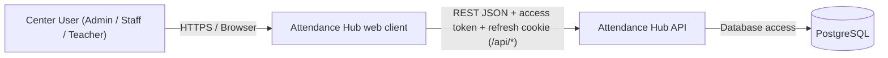
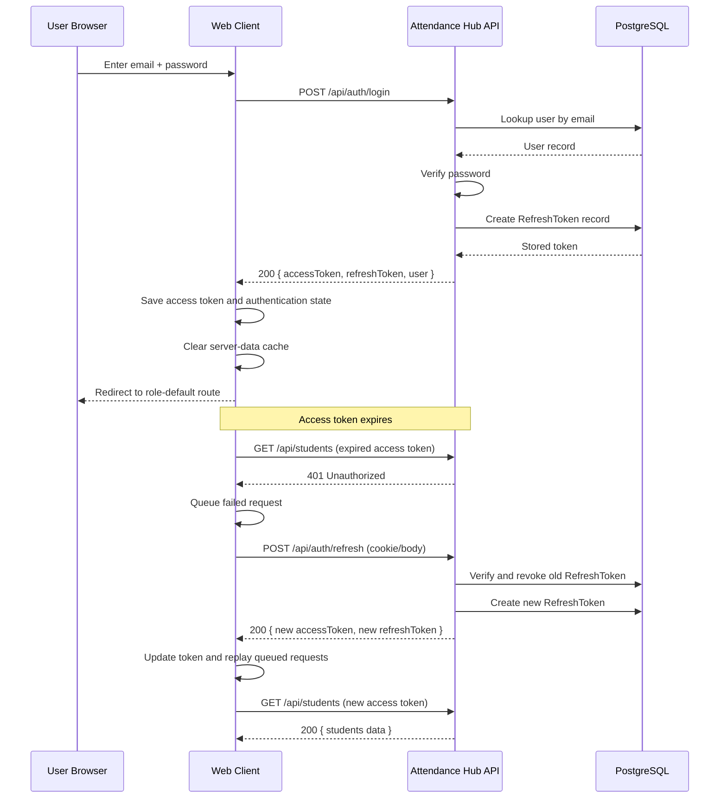
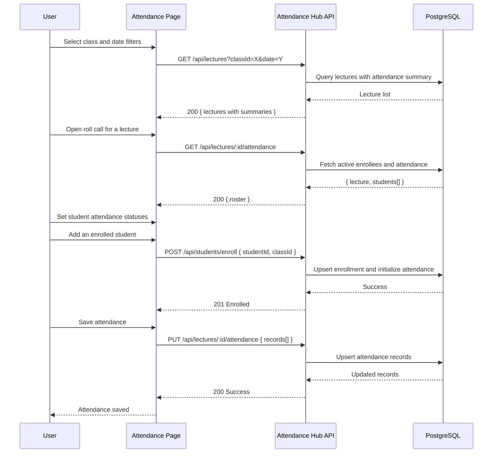

# Software Requirements Specification
## Student Attendance System (Attendance Hub)

| Metadata | Details |
|---|---|
| Document version | 1.3.0 |
| Date | 2026-11-25 |
| Owner | Osama Ahmed (`UsamaA7med`) |
| Repository | `git@github.com:UsamaA7med/attendance-system.git` |
| Alignment | ISO/IEC/IEEE 29148 / IEEE 830 structure |
| Status | Current-state specification; legacy and planned capabilities are identified separately |
| Baseline | Source SRS v1.2.0 and the stated current implementation |

This document restructures the existing specification. It does not assert independent certification or conformance to either standard.

## 1. Introduction

### 1.1 Purpose

This SRS defines verifiable functional and quality requirements for the Student Attendance System. It is intended for product stakeholders, developers, testers, operators, and maintainers. It distinguishes current behavior from legacy behavior and future work.

### 1.2 Scope

The system supports educational centers and academies with:

- Authentication, session lifecycle, and role-based access for administrators, operational staff, and teachers.
- Administration of staff, teachers, classes, students, enrollments, and scheduled lectures.
- Lecture-based student roll call and attendance records.
- Role-scoped attendance reports and Excel workbook export.
- A separate legacy employee check-in/check-out API, which is not the data source for student attendance reports.

Student attendance history and CSV/PDF report export are planned, not current capabilities.

### 1.3 Definitions, Acronyms, Abbreviations

| Term | Definition |
|---|---|
| API | Application Programming Interface. |
| Access token | Short-lived credential used to authenticate API requests. |
| Refresh token | Longer-lived credential that can be exchanged for a new token pair and is tracked for revocation. |
| Attendance record | A student status associated with one lecture. |
| Attendance status | One of `PRESENT`, `ABSENT`, `LATE`, or `EXCUSED`. |
| CUID | Collision-resistant unique identifier used by the current data layer. |
| DTO | Data Transfer Object at an application boundary. |
| Enrollment | Association between a student and a class, with `ACTIVE` or `DROPPED` status. |
| JWT | JSON Web Token. |
| ORM | Object-Relational Mapping. |
| RBAC | Role-Based Access Control. |
| Roll call | Recording attendance status for students in a lecture. |
| SPA | Single-Page Application. |
| Safe user | User profile response that excludes the password hash. |
| API envelope | Common JSON response with success indicator, message, data or errors, and timestamp; paginated lists may include pagination metadata. |

### 1.4 References

- Project architecture and conventions: [AGENTS.md](../AGENTS.md)
- Current database schema: [server/prisma/schema.prisma](../server/prisma/schema.prisma)
- Server application: [server/src/app.ts](../server/src/app.ts)
- Client routing: [client/src/App.tsx](../client/src/App.tsx)
- Deployment routing: [vercel.json](../vercel.json)
- Source SRS revision 1.2.0, used as the content baseline for this revision.

### 1.5 Overview

Section 2 describes the product context, functions, users, environment, constraints, and assumptions. Section 3 defines the external interfaces, functional requirements, performance requirements, design constraints, quality attributes, and other requirements. Section 4 maps each requirement to verification. Appendices contain the data model, API reference, seed baseline, state notes, limitations, and revision history. The final section lists open questions.

## 2. Overall Description

### 2.1 Product Perspective

The product is a browser-based frontend communicating with a REST API and a PostgreSQL database. The current deployment supports local operation and a unified cloud deployment.



The current system is a web application with a persisted educational attendance domain. The legacy employee attendance API uses in-memory data and is independent of the student attendance reporting workflow.

### 2.2 Product Functions

The system provides:

1. Sign-in, controlled account provisioning, token refresh, logout, and current-user profile retrieval.
2. Role- and ownership-based access control.
3. Teacher and staff account administration, including filters, metrics, and deletion safeguards.
4. Class creation and management, including teacher assignment and scoped teacher access.
5. Lecture scheduling, uniqueness enforcement, and automatic attendance-record initialization.
6. Student administration, class enrollment, filtering, metrics, and teacher-scoped read access.
7. Roll-call roster retrieval, individual and bulk status assignment, and on-the-fly enrollment.
8. Attendance metrics and reports with date ranges, charts, and Excel export.
9. A legacy employee attendance API and legacy overview endpoint.

### 2.3 User Classes and Characteristics

| User class | Role | Responsibilities | Access scope | Default landing page |
|---|---|---|---|---|
| Administrator | `ADMIN` | Manages center users, teachers, staff, classes, lectures, students, attendance, and reports. | Center-wide. | `/attendance` |
| Operational staff | `STAFF` | Manages students and enrollments, schedules lectures, conducts roll call, and views reports. | Center-wide for permitted workflows. Does not have a dedicated Classes page; has read-only class API access. | `/attendance` |
| Teacher | `TEACHER` | Manages own classes and lectures, conducts roll call, and views enrolled students and reports. | Limited to assigned classes and students with active enrollment in those classes; student records are read-only. | `/classes` |

The role access matrix is in [3.2.2](#322-role-access-matrix).

### 2.4 Operating Environment

- Client: modern evergreen browsers supporting JavaScript modules, local storage, and HTTP-only cookies; the original specification names Chrome, Firefox, Edge, and Safari.
- Server: Node.js runtime and Express-based HTTP service.
- Data store: PostgreSQL, including hosted pooled connections in the current production setup.
- Deployment: Vercel is the current cloud deployment target; local development is also supported.
- Network: browser-to-service traffic uses HTTP(S); production access is expected to use HTTPS.

Specific supported browser versions and a formal minimum client device profile are not stated in the source.

### 2.5 Design and Implementation Constraints

The following are current implementation/deployment constraints rather than user-visible behavior:

- The persisted application data store is PostgreSQL.
- The server uses a modular monolith, organized by business feature, with request routing, controller, service, and repository responsibilities.
- The current deployment target is Vercel; the system supports both combined and separate frontend/backend deployment configurations.
- Authentication currently uses signed access and refresh tokens. Refresh-token records are persisted to support revocation and rotation.
- The server uses a PostgreSQL ORM client; the frontend is a browser-based SPA.
- User provisioning is closed to public self-registration and reserved for an administrator.

Technical choices, deployment details, and module organization are recorded in Appendices B and D. They are not independent functional requirements.

### 2.6 Assumptions and Dependencies

- A reachable PostgreSQL service and valid database connection configuration are available in the deployed environment.
- API server clocks are synchronized sufficiently for token expiry and UTC-date operations.
- Production client and server origins, cookie policy, and credentialed cross-origin requests are configured consistently.
- An administrator provisions staff and teacher accounts.
- [ASSUMED] For proposed performance acceptance targets in Section 3.3, the test environment has a stable network and representative seeded data; exact production data volumes and hardware are not defined.

## 3. Specific Requirements

### 3.1 External Interface Requirements

#### 3.1.1 User Interfaces

The system presents:

- A sign-in page with email and password inputs.
- Role-filtered navigation and role-specific default landing pages.
- Attendance, reports, classes, lectures, students, teachers, and staff pages as permitted by the access matrix.
- Search/filter controls, paginated tables, loading placeholders, empty states, retry feedback where provided, and confirmation dialogs for destructive actions.
- A profile area displaying the signed-in user's name, email, role, and sign-out action.
- Reports with selectable recent date ranges, metrics, visual summaries, and an Excel export action.
- Notifications for operation results and a network activity indicator.

#### 3.1.2 Hardware Interfaces

No specialized hardware interface is specified. The system requires a device capable of running a supported browser and communicating over a network.

#### 3.1.3 Software Interfaces

The system interfaces with:

- A PostgreSQL database for persisted users, refresh tokens, students, classes, enrollments, lectures, and attendance records.
- A browser client and REST API using JSON.
- An Excel workbook file generated by the Reports feature.
- Deployment/runtime configuration for database access, client origin, token secrets and expiry, cookie policy, and API base URL.

#### 3.1.4 Communications Interfaces

- The client communicates with the API through REST endpoints under `/api`.
- Authentication requests use an access-token bearer credential; refresh-token exchange supports an HTTP-only cookie and programmatic request-body token.
- Credentialed requests are enabled for cookie-based refresh.
- Production browser/API communication is expected to use HTTPS.
- CORS allows configured client origins and the development origins described in Appendix B.

### 3.2 Functional Requirements

Unless stated otherwise, the requirements in 3.2 describe current behavior. Each requirement has one priority and at least one acceptance criterion. `Must`, `Should`, and `Could` indicate relative product priority, not a claim of standards certification.

#### 3.2.1 Authentication and Session Management

| ID | Requirement | Priority | Acceptance criteria |
|---|---|---|---|
| FR-AUTH-01 | The system shall authenticate a user only when the submitted email and password match an active account. | Must | Given invalid credentials or an inactive account, when login is submitted, then authentication fails with HTTP 401. |
| FR-AUTH-02 | The system shall issue an access token and a refresh token after successful login. | Must | Given valid credentials, when login succeeds, then the response includes an access token and a refresh token, and the refresh token is tracked for revocation. |
| FR-AUTH-03 | The system shall permit only an authenticated administrator to create a staff account through registration. | Must | Given a non-administrator or unauthenticated caller, when registration is requested, then the request is denied; an authorized administrator can create a valid account. |
| FR-AUTH-04 | The system shall reject account creation when the email address is already in use. | Must | Given an existing email, when account creation is submitted, then the system returns HTTP 409 and creates no account. |
| FR-AUTH-05 | The system shall redirect unauthenticated visitors from the public registration page to sign-in. | Must | Given an unauthenticated visitor, when `/register` is opened, then the browser navigates to `/login`. |
| FR-AUTH-06 | The system shall rotate a valid refresh token when it is exchanged for a new token pair. | Must | Given an active, unexpired refresh token, when refresh is requested, then the old token is revoked and a new pair is issued. |
| FR-AUTH-07 | The system shall revoke all refresh tokens for an account when a revoked token is reused more than 15 seconds after revocation. | Must | Given a revoked token older than 15 seconds, when it is reused, then the request is rejected and all refresh tokens for its account are revoked. |
| FR-AUTH-08 | The system shall reject reuse of a refresh token within 15 seconds of revocation without revoking other sessions. | Must | Given a token revoked no more than 15 seconds earlier, when reused, then the request is rejected and other refresh tokens remain valid. |
| FR-AUTH-09 | The system shall revoke the supplied refresh token when logout is requested. | Must | Given a logout request with a refresh token, when it completes, then that token is no longer usable. |
| FR-AUTH-10 | The system shall clear the refresh-token cookie when logout is requested. | Must | Given a logout request, when it completes, then the response clears the refresh-token cookie. |
| FR-AUTH-11 | The system shall revoke all refresh tokens belonging to the authenticated user when that user logs out. | Must | Given an authenticated logout request, when it completes, then no refresh token for that user remains usable. |
| FR-AUTH-12 | The system shall return the authenticated user's safe profile without a password hash. | Must | Given an authenticated request for the current profile, when the response is inspected, then it contains profile data and no password hash. |
| FR-AUTH-13 | The client shall make one refresh request for concurrent non-authentication API requests that fail with HTTP 401. | Must | Given multiple simultaneous eligible 401 responses, when handled, then only one refresh request occurs. |
| FR-AUTH-14 | The client shall retry failed requests after a successful refresh. | Must | Given a request that failed with HTTP 401 and a successful token refresh, when refresh completes, then the original request is retried. |
| FR-AUTH-15 | The client shall clear authentication state and notify the application when token refresh fails. | Must | Given refresh failure, when the response is handled, then the saved token is cleared and the application receives the expiration event. |
| FR-AUTH-16 | The client shall clear cached server data when the authenticated identity is set or removed. | Must | Given login, account switch, or logout, when authentication state changes, then cached server data is cleared. |

#### 3.2.2 Role Access Matrix

| Route / function | `ADMIN` | `STAFF` | `TEACHER` |
|---|---|---|---|
| `/attendance` | All classes | All classes | Own classes only |
| `/reports` | All classes | All classes | Own classes only |
| `/classes` page | Full management, all classes | Hidden and guarded | Own classes; full permitted class management |
| Class API reads | All classes | Read-only access | Own classes |
| `/lectures` | All classes | All classes | Own classes only |
| `/students` | Full management and enrollment | Full management and enrollment | Read-only; students enrolled in own classes |
| `/teachers` | Full management | Forbidden | Forbidden |
| `/staff` | Full management | Forbidden | Forbidden |
| `/api/users` reads | Allowed | Allowed | Forbidden |
| `/api/users` writes | Allowed | Forbidden | Forbidden |

| ID | Requirement | Priority | Acceptance criteria |
|---|---|---|---|
| FR-RBAC-01 | The system shall redirect unauthenticated users from every protected page to `/login`. | Must | Given no authenticated session, when a protected route is opened, then the browser navigates to `/login`. |
| FR-RBAC-02 | The system shall redirect authenticated users from `/login` and `/register` to the root route. | Must | Given an authenticated user, when either public route is opened, then the browser navigates to `/`. |
| FR-RBAC-03 | The system shall route teachers from `/` to `/classes` and administrators and staff from `/` to `/attendance`. | Must | Given each role, when the root route is opened, then the user lands on the role-specific route shown in this requirement. |
| FR-RBAC-04 | The system shall restrict each role's page and API permissions to the access matrix in this section. | Must | Given a role without permission for a listed route or operation, when access is attempted, then the page is blocked or the API returns HTTP 403. |
| FR-RBAC-05 | The system shall limit teacher class queries and class access to classes assigned to that teacher. | Must | Given a teacher and another teacher's class, when the class is queried or modified, then it is absent from list results or access is denied with HTTP 403. |
| FR-RBAC-06 | The system shall assign a teacher-created class to the creating teacher and prevent that teacher from reassigning it. | Must | Given a teacher creating or updating a class, when the request is processed, then ownership remains the authenticated teacher. |
| FR-RBAC-07 | The system shall limit teacher lecture operations to lectures belonging to the teacher's assigned classes. | Must | Given a teacher and a lecture for another teacher's class, when the teacher accesses or changes it, then access is denied with HTTP 403. |
| FR-RBAC-08 | The system shall limit teacher student reads to students actively enrolled in the teacher's assigned classes. | Must | Given a teacher and a student with no active enrollment in the teacher's classes, when that student is requested, then access is denied or the student is excluded from results. |
| FR-RBAC-09 | The system shall deny teachers all student create, update, delete, and enrollment operations. | Must | Given a teacher, when any student write operation is attempted, then the API returns HTTP 403. |
| FR-RBAC-10 | The system shall allow staff to read class data through the class API without granting staff access to the Classes page or class write operations. | Must | Given staff, when class API read and write operations are attempted, then reads are permitted and the page/write operations are denied. |

#### 3.2.3 Teacher Management

| ID | Requirement | Priority | Acceptance criteria |
|---|---|---|---|
| FR-TEACH-01 | The system shall restrict teacher-management operations to administrators. | Must | Given a non-administrator, when any teacher endpoint is requested, then the API returns HTTP 403. |
| FR-TEACH-02 | The system shall list teachers with search, active-status filtering, pagination, and newest-first ordering. | Must | Given matching and non-matching teachers, when filters and page/limit are supplied, then only matching records for the requested page are returned in descending creation order. |
| FR-TEACH-03 | The system shall report teacher metrics containing total accounts, active accounts, and the current active-class count represented by `totalClassesAssigned`. | Should | Given known teacher and active-class counts, when metrics are requested, then all three values match the documented definitions. |
| FR-TEACH-04 | The system shall create a teacher account with a name of at least two characters, unique email, password of at least six characters, and optional phone, department, position, and active status. | Must | Given valid values, when an administrator creates a teacher, then the account is returned; invalid required values are rejected. |
| FR-TEACH-05 | The system shall normalize teacher email addresses to lowercase when creating or updating an account. | Must | Given mixed-case email input, when saved, then the stored email is lowercase. |
| FR-TEACH-06 | The system shall permit partial teacher updates and change a password only when a non-empty password of at least six characters is supplied. | Must | Given a partial update without password, when saved, then other requested fields change and the password remains unchanged. |
| FR-TEACH-07 | The system shall reject a teacher deletion when that account has assigned classes, created lectures, or marked attendance records. | Must | Given a teacher with any such relation, when deletion is requested, then the API returns HTTP 409 and preserves the account. |
| FR-TEACH-08 | The system shall reject deletion through the teacher endpoint when the target account is not a teacher. | Must | Given a non-teacher account ID, when deletion is requested, then the API returns HTTP 400. |

#### 3.2.4 Staff Management

| ID | Requirement | Priority | Acceptance criteria |
|---|---|---|---|
| FR-STAFF-01 | The system shall restrict staff-management operations to administrators. | Must | Given a non-administrator, when any staff endpoint is requested, then the API returns HTTP 403. |
| FR-STAFF-02 | The system shall list staff with search, active-status filtering, pagination, and newest-first ordering. | Must | Given matching and non-matching staff accounts, when filters and page/limit are supplied, then only matching records for the requested page are returned in descending creation order. |
| FR-STAFF-03 | The system shall return staff metrics containing total, active, and inactive account counts. | Should | Given known staff account statuses, when metrics are requested, then inactive count equals total count minus active count. |
| FR-STAFF-04 | The system shall create and update staff accounts using a name of at least two characters, unique email, required-on-create password of at least six characters, optional phone, department, position, and active status. | Must | Given valid create/update values, when saved, then values are stored; invalid required values are rejected. |
| FR-STAFF-05 | The system shall normalize staff email addresses to lowercase on account creation and update. | Must | Given mixed-case email input, when saved, then the stored email is lowercase. |
| FR-STAFF-06 | The system shall reject staff deletion when the target account has created lectures or marked attendance records. | Must | Given a staff account with either relation, when deletion is requested, then the API returns HTTP 409 and preserves the account. |
| FR-STAFF-07 | The system shall reject deletion through the staff endpoint when the target account is not staff. | Must | Given a non-staff account ID, when deletion is requested, then the API returns HTTP 400. |

#### 3.2.5 Class Management

| ID | Requirement | Priority | Acceptance criteria |
|---|---|---|---|
| FR-CLS-01 | The system shall create classes with a name of 2–100 characters, optional description, room of at most 50 characters, and active status. | Must | Given valid class values, when saved, then a class is created; invalid field lengths are rejected. |
| FR-CLS-02 | The system shall require an administrator to specify a teacher for class creation and shall verify that teacher exists and is active. | Must | Given a missing, nonexistent, or inactive teacher, when an administrator creates a class, then the request is rejected. |
| FR-CLS-03 | The system shall list classes using search, teacher, and active-status filters with pagination and newest-first ordering. | Must | Given filter values, when a class list is requested, then the returned page contains only matching classes in descending creation order. |
| FR-CLS-04 | The system shall include no more than five recent lectures in each class list item. | Should | Given a class with more than five lectures, when the class list is requested, then each item includes at most five lectures ordered by date descending and start time ascending. |
| FR-CLS-05 | The system shall return class metrics for total classes, active classes, lectures, and active enrollments. | Should | Given known records, when metrics are requested, then counts match those records; teacher counts include only owned classes. |
| FR-CLS-06 | The system shall permit an administrator to reassign a class only to an existing active teacher. | Must | Given a valid active teacher, when an administrator updates class ownership, then ownership changes; invalid or inactive teacher IDs are rejected. |
| FR-CLS-07 | The system shall delete a class and its enrollments, lectures, and lecture attendance records. | Must | Given a class with related records, when it is deleted, then the class and its dependent records no longer exist. |

#### 3.2.6 Lecture Management

| ID | Requirement | Priority | Acceptance criteria |
|---|---|---|---|
| FR-LEC-01 | The system shall schedule a lecture for an existing class using a `YYYY-MM-DD` date and `HH:mm` start time, with optional notes. | Must | Given valid values and an existing class, when submitted, then the lecture is created; invalid dates/times are rejected. |
| FR-LEC-02 | The system shall reject a second lecture for the same class, date, and start time. | Must | Given an existing lecture at that class/date/time, when another is scheduled, then the API returns HTTP 409. |
| FR-LEC-03 | The system shall prevent teachers from scheduling a lecture for a class they do not own. | Must | Given a teacher and a class owned by another teacher, when scheduling is attempted, then the API returns HTTP 403. |
| FR-LEC-04 | The system shall initialize a `PRESENT` attendance record for each actively enrolled student when a lecture is created. | Must | Given active enrollments in a class, when a lecture is created, then each enrolled student has a `PRESENT` attendance record for that lecture. |
| FR-LEC-05 | The system shall list lectures with class, date, date-range, and text-search filters, with pagination and date-descending/start-time-ascending ordering. | Must | Given filters and matching lectures, when the list is requested, then only matches are returned in the specified order. |
| FR-LEC-06 | The system shall allow lecture date, start time, and notes to be updated without creating a duplicate class/date/time slot. | Must | Given an update that conflicts with another lecture, when submitted, then HTTP 409 is returned and the lecture remains unchanged. |
| FR-LEC-07 | The system shall delete a lecture and its attendance records. | Must | Given a lecture with attendance records, when it is deleted, then the lecture and its attendance records no longer exist. |

#### 3.2.7 Student and Enrollment Management

| ID | Requirement | Priority | Acceptance criteria |
|---|---|---|---|
| FR-STU-01 | The system shall create a student with full name and parent name of 2–100 characters, parent phone of 8–20 characters, optional phone matching the accepted phone character/length rule, and optional notes of at most 500 characters. | Must | Given valid student fields, when created, then the record is saved; invalid lengths or phone format are rejected. |
| FR-STU-02 | The system shall permit student creation with an optional initial class enrollment only when the class exists and is active. | Must | Given an active class ID, when the student is created with that ID, then an active enrollment is created; missing or inactive class is rejected. |
| FR-STU-03 | The system shall create `PRESENT` attendance records for a newly enrolled student for that class's lectures on the current UTC date. | Must | Given today's lectures in the selected class, when a student is enrolled, then the student has a `PRESENT` record for each such lecture. |
| FR-STU-04 | The system shall enroll an existing student in an active class and reactivate a previously dropped enrollment rather than creating a duplicate. | Must | Given an existing dropped student/class enrollment, when enrollment is requested, then the existing enrollment becomes active and remains unique. |
| FR-STU-05 | The system shall initialize `PRESENT` attendance for today's class lectures when an existing student is enrolled. | Must | Given today's lectures in the target class, when enrollment succeeds, then the student has a `PRESENT` record for each lecture. |
| FR-STU-06 | The system shall list and search students by name, parent name, phone, and parent phone, and support class, excluded-class, active-status, and pagination filters. | Must | Given matching and non-matching student records, when filters are supplied, then only matching records are returned. |
| FR-STU-07 | The system shall sort student lists by full name in ascending order. | Should | Given at least two matching students, when listed, then names are in ascending order. |
| FR-STU-08 | The system shall return student metrics for total, active, inactive, and enrollment counts. | Should | Given known student and enrollment records, when metrics are requested, then the counts match; teacher metrics are scoped to owned classes. |
| FR-STU-09 | The system shall delete a student and all associated attendance and enrollment records as one indivisible operation. | Must | Given a student with related records, when deletion succeeds, then all are removed; if the operation fails, none are partially removed. |

#### 3.2.8 Roll Call and Attendance Workflow

| ID | Requirement | Priority | Acceptance criteria |
|---|---|---|---|
| FR-ROLL-01 | The system shall return a lecture's active enrolled students in alphabetical order with their attendance status and marking details. | Must | Given active enrolled students, when the roster is requested, then every active enrollee appears in alphabetical order with persisted or default `PRESENT` status. |
| FR-ROLL-02 | The system shall reject a teacher's request to view a roll-call roster for a lecture outside the teacher's classes. | Must | Given a non-owned lecture, when a teacher requests its roster, then the API returns HTTP 403. |
| FR-ROLL-03 | The system shall save submitted attendance statuses from the allowed status set for the selected lecture and students. | Must | Given valid student/status records, when submitted, then records are created or updated for the lecture; invalid statuses are rejected. |
| FR-ROLL-04 | The system shall record the current user and current time when attendance is submitted. | Must | Given a successful roll-call update, when its record is retrieved, then its marker and marking time reflect the submission. |
| FR-ROLL-05 | The roll-call interface shall allow the user to apply one allowed status to all currently displayed students in one action. | Should | Given a displayed roster, when a bulk status is selected, then every displayed student receives that status before save. |
| FR-ROLL-06 | The roll-call interface shall allow authorized users to search for and select active, unenrolled students for enrollment in the lecture's class. | Should | Given an active unenrolled student, when found and selected, then the student is enrolled in that class and appears in the roll-call workflow. |
| FR-ROLL-07 | The attendance page shall display filtered session count, student count, present count, absent count, and attendance rate. | Should | Given a filtered set of sessions and records, when metrics render, then counts match the records and rate equals rounded present/total-marked × 100. |

#### 3.2.9 User Account API

| ID | Requirement | Priority | Acceptance criteria |
|---|---|---|---|
| FR-USR-01 | The system shall allow administrators and staff to read user accounts without exposing password hashes. | Must | Given an administrator or staff caller, when a user is retrieved, then the response omits password hash data. |
| FR-USR-02 | The system shall restrict user creation, update, and deletion to administrators. | Must | Given a non-administrator, when any user write operation is attempted, then the API returns HTTP 403. |

#### 3.2.10 Student Attendance Reports

| ID | Requirement | Priority | Acceptance criteria |
|---|---|---|---|
| FR-REP-01 | The system shall make the Reports page available to all three roles and restrict teacher report data to the teacher's own classes. | Must | Given each role, when reports load, then the page is available and teacher results exclude non-owned classes. |
| FR-REP-02 | The system shall derive student attendance reports from lecture data rather than the legacy employee overview endpoint. | Must | Given the Reports page is loaded, when its data requests are inspected, then lecture data is used and the legacy overview endpoint is not required. |
| FR-REP-03 | The system shall allow the user to select a reporting range of the most recent 7, 30, or 90 calendar days, including the current date. | Must | Given each available range, when selected, then the report includes the selected number of calendar dates through today. |
| FR-REP-04 | The system shall display attendance rate, attendance record count, lecture session count, and classes reporting for the selected range. | Must | Given report records, when metrics are calculated, then rate is rounded present/(present+absent+late+excused) × 100, is 0% for no records, session count includes returned lectures, and reporting classes have at least one record. |
| FR-REP-05 | The system shall display daily attendance counts by status, status distribution, and attendance rates by class. | Must | Given attendance records, when charts render, then each chart's values match the selected-range records. |
| FR-REP-06 | The system shall limit the class attendance chart to the eight highest-rate classes that have attendance records. | Should | Given more than eight reporting classes, when the chart renders, then it contains no more than eight classes ordered by calculated rate descending. |
| FR-REP-07 | The system shall export the selected report range as an Excel workbook with Summary, Daily Attendance, Status Breakdown, and Class Attendance worksheets. | Must | Given a selected range, when export is requested, then the workbook contains all four named worksheets. |
| FR-REP-08 | The system shall use the same filtered lecture data and calculations for the report display and its workbook export. | Must | Given a selected range, when displayed values are compared to exported values, then the corresponding values match. |

#### 3.2.11 Legacy Employee Attendance

These requirements are retained as **Legacy** and do not describe the active student attendance feature.

| ID | Requirement | Priority | Acceptance criteria |
|---|---|---|---|
| FR-LEG-01 | The legacy attendance API shall permit administrators and staff to check employees in and out, list records, retrieve a record, and retrieve today's summary. | Could | Given an authorized administrator or staff user, when a supported legacy endpoint is called, then it returns the corresponding operation result. |
| FR-LEG-02 | The legacy employee workflow shall permit no more than one active check-in per employee per day. | Could | Given an employee already checked in that day, when another check-in is submitted, then the second active check-in is rejected. |
| FR-LEG-03 | The legacy employee workflow shall classify a check-in after 09:15 AM as late. | Could | Given a check-in time later than 09:15 AM, when processed, then its status is `late`. |
| FR-LEG-04 | The legacy overview endpoint shall report summary metrics from the legacy employee attendance records for administrators and staff. | Could | Given legacy records, when an authorized user requests the overview, then the response is calculated from those records. |

#### 3.2.12 Planned Work (Not Current Requirements)

The following items are explicitly **Planned** in the source and are not represented as current capabilities or committed requirements:

- Student attendance history.
- CSV report export.
- PDF report export.

#### 3.2.13 Search and Filter Semantics

Current search targets, retained here as functional contract detail:

| Feature | Search targets |
|---|---|
| Teachers | Name, email, phone, department; case-insensitive. |
| Staff | Name, email, phone, department, position; case-insensitive. |
| Classes | Name, description, room, teacher name; case-insensitive. |
| Lectures | Class name, class room, notes; case-insensitive. |
| Students | Full name and parent name case-insensitive; phone and parent phone by exact substring matching. |

### 3.3 Performance Requirements

Performance targets not supplied by the source are marked **[ASSUMED]** and require stakeholder confirmation.

| ID | Requirement | Acceptance criteria |
|---|---|---|
| NFR-PERF-01 | The system shall return a successful API response within 2 seconds for at least 95% of requests under the agreed representative QA workload. **[ASSUMED]** | Run a 15-minute load test with 100 concurrent virtual users and representative seeded data; at least 95% of successful requests complete within 2 seconds. |
| NFR-PERF-02 | The system shall render a usable initial page within 3 seconds for at least 95% of page loads on the agreed reference client and network. **[ASSUMED]** | Measure 20 cold page loads under the agreed reference profile; at least 19 reach usable content within 3 seconds. |
| NFR-PERF-03 | Paginated list requests shall use a default page size of 10 and shall not return more than 100 records per page. | Request a list without a limit and with a limit above 100; response sizes are respectively at most 10 and 100. |
| NFR-PERF-04 | Search results shall reflect a changed search term no later than 300 ms after the user stops typing, excluding network response time. | With a controlled clock, verify the search request is not issued before 300 ms of inactivity and is issued at that point. |
| NFR-PERF-05 | The client shall abort an API request that has not completed within 10 seconds. | Hold an API response beyond 10 seconds; the client reports a timeout and does not continue waiting. |
| NFR-PERF-06 | The system shall compress eligible API responses when the client advertises supported compression. | Request a compressible response with gzip support; verify a compressed response encoding is returned. |

The current implementation's query cache times, connection pool limits, indexes, query strategy, and render optimizations are documented in Appendix D; those implementation settings are not standalone user-visible performance targets.

### 3.4 Design Constraints

| ID | Constraint |
|---|---|
| NFR-DC-01 | The active education domain shall persist data in PostgreSQL. |
| NFR-DC-02 | The system shall disable public self-registration and reserve staff and teacher account provisioning for administrators. |
| NFR-DC-03 | The system shall interpret lecture dates as UTC calendar dates in `YYYY-MM-DD` format. |
| NFR-DC-04 | The system shall represent lecture start times in 24-hour `HH:mm` format. |
| NFR-DC-05 | The system shall prevent deletion of a teacher or staff account while protected dependent records exist, as defined in Appendix A. |
| NFR-DC-06 | The system shall cascade class deletion to that class's enrollments, lectures, and attendance records. |
| NFR-DC-07 | The system shall remove a student's attendance and enrollment records atomically with deletion of that student. |
| NFR-DC-08 | The system shall use the success, error, and pagination response shapes documented in Appendix B. |
| NFR-DC-09 | The system shall retain the current approved runtime, application framework, database access, client, and deployment technology choices unless an architecture change is approved. |

### 3.5 Software System Quality Attributes

#### 3.5.1 Security

| ID | Requirement | Acceptance criteria |
|---|---|---|
| NFR-SEC-01 | The system shall include security-related HTTP response headers on API responses. | Verify configured security headers are present on successful and error responses. |
| NFR-SEC-02 | The system shall store passwords only as salted hashes with a work factor of at least 10. | Inspect stored credentials; values are salted hashes with a work factor of at least 10. |
| NFR-SEC-03 | The system shall never include password hashes in API responses. | Inspect representative account responses; no password hash is present. |
| NFR-SEC-04 | The system shall validate request body, query, and path parameters before processing an API operation. | Submit invalid values in each input location; each is rejected with a client error before a data mutation occurs. |
| NFR-SEC-05 | The system shall use access tokens with a 15-minute default lifetime. | Inspect access-token expiry claims under default configuration; lifetime is 15 minutes. |
| NFR-SEC-06 | The system shall use refresh tokens with a 7-day default lifetime. | Inspect refresh-token expiry claims under default configuration; lifetime is 7 days. |
| NFR-SEC-07 | The system shall store refresh tokens in HTTP-only cookies. | Inspect the authentication response; the refresh-token cookie has the HTTP-only attribute. |
| NFR-SEC-08 | The system shall revoke each refresh token when it is successfully exchanged. | Exchange a valid refresh token; verify the exchanged token is no longer usable. |
| NFR-SEC-09 | The system shall use parameterized database operations for data values. | Inspect database access paths and verify user-supplied values are bound as parameters rather than concatenated into SQL. |
| NFR-SEC-10 | The system shall omit internal stack traces from production HTTP 500 responses. | Cause a controlled server error in production-mode test configuration; response contains no stack trace. |
| NFR-SEC-11 | The system shall normalize email addresses to lowercase before persistence. | Create and update accounts with mixed-case email; persisted value is lowercase and duplicate variants conflict. |

#### 3.5.2 Reliability

| ID | Requirement | Acceptance criteria |
|---|---|---|
| NFR-REL-01 | The system shall enforce uniqueness of account email addresses. | Attempt to create two accounts with the same email; the second is rejected. |
| NFR-REL-02 | The system shall enforce uniqueness of each student/class enrollment pair. | Attempt to create a duplicate enrollment; it is rejected. |
| NFR-REL-03 | The system shall enforce uniqueness of each class/date/start-time lecture slot. | Attempt to schedule a duplicate lecture slot; it is rejected. |
| NFR-REL-04 | The system shall enforce uniqueness of each lecture/student attendance pair. | Attempt to create duplicate attendance for a lecture/student pair; it is rejected. |
| NFR-REL-05 | The system shall perform multi-record destructive student deletion atomically. | Force a failure during deletion; verify the student, enrollments, and attendance records remain consistent and are not partially removed. |
| NFR-REL-06 | The system shall expose a public health endpoint that reports service health, uptime, and timestamp. | Request `/health`; verify a successful response contains all three values. |
| NFR-REL-07 | The system shall reject an invalid, expired, revoked, or reused refresh token. | Submit each invalid token state; each request is rejected with HTTP 401. |

#### 3.5.3 Usability

| ID | Requirement | Acceptance criteria |
|---|---|---|
| NFR-USE-01 | The system shall support usable page layouts at viewport widths from 375 px through 1440 px. **[ASSUMED]** | Test each primary page at 375 px, 768 px, and 1440 px; controls remain operable and content is not clipped outside intentional horizontal table scrolling. |
| NFR-USE-02 | A modal shall close on Escape when no mutation is pending. | Open a modal with no pending mutation, press Escape, and verify it closes; repeat while pending and verify it remains open. |
| NFR-USE-03 | Asynchronous table and roll-call loading shall display structural loading placeholders. | Delay the corresponding response and verify placeholders appear until data is available. |
| NFR-USE-04 | The system shall provide an empty-data state and a retry action when report data cannot be loaded. | Cause report loading to fail; verify an error state and usable retry action appear. |
| NFR-USE-05 | The system shall provide user-visible success or failure feedback for completed asynchronous operations. | Complete and fail representative create/update/delete actions; verify corresponding notification feedback. |

#### 3.5.4 Maintainability

| ID | Requirement | Acceptance criteria |
|---|---|---|
| NFR-MAINT-01 | The server and client shall pass their configured static type checks. | Run the server type-check and client project build/type-check; both exit successfully. |
| NFR-MAINT-02 | The client shall pass its configured lint checks. | Run the client lint command; it exits successfully. |
| NFR-MAINT-03 | Backend business domains shall remain separated into feature modules with distinct request, business, and data-access responsibilities. | Architecture review verifies that each active domain follows the documented module boundaries and does not place database/business logic in request handlers. |

#### 3.5.5 Portability

| ID | Requirement | Acceptance criteria |
|---|---|---|
| NFR-PORT-01 | The system shall support local operation and the configured cloud deployment without changing business behavior. | Run the agreed smoke test in local and deployed environments; login, core attendance workflows, and API health behave consistently. |

### 3.6 Other Requirements

#### 3.6.1 Error Handling

The current API error contract uses HTTP 400 for invalid input, 401 for unauthenticated or invalid-token requests, 403 for disallowed roles/ownership, 404 for absent resources/routes, 409 for uniqueness or referential conflicts, and 500 for unexpected failures. See Appendix B for response shape.

#### 3.6.2 Attendance Reporting Interpretation

Lecture creation initializes attendance records to `PRESENT`. Those records contribute to report calculations until changed during roll call. There is no separate roll-call-completed state; therefore, the current report rate is a proportion of records marked `PRESENT`, not a completion-verified attendance rate. This limitation is captured in Appendix E.

## 4. Verification

Verification methods below identify the primary evidence for each requirement. Tests may be API, UI, integration, static-analysis, or inspection tests as appropriate.

| Requirement IDs | Verification method |
|---|---|
| FR-AUTH-01–16 | Authentication integration tests: active/inactive credentials, token issuance/rotation/replay/logout/profile, concurrent 401 refresh, and cache isolation. |
| FR-RBAC-01–10 | Role-by-route and role-by-endpoint matrix tests; ownership tests for classes, lectures, and students. |
| FR-TEACH-01–08 | Administrator CRUD/API tests; search, filters, metrics, validation, normalization, and referential-delete conflict tests. |
| FR-STAFF-01–07 | Administrator CRUD/API tests; search, filters, metrics, validation, normalization, and referential-delete conflict tests. |
| FR-CLS-01–07 | Class API tests for validation, assignment, filtering, metrics, five-lecture limit, cascade deletion, and role access. |
| FR-LEC-01–07 | Lecture API tests for date/time validation, uniqueness, ownership, attendance initialization, filtering, update conflict, and cascade deletion. |
| FR-STU-01–09 | Student/enrollment API tests for validation, enrollment upsert, same-day attendance, filters, metrics, sorting, and atomic deletion. |
| FR-ROLL-01–07 | Roll-call UI/API integration tests for roster, ownership, status upsert, marker/time, bulk actions, enrollment, and displayed metrics. |
| FR-USR-01–02 | User API authorization and response projection tests. |
| FR-REP-01–08 | Report integration/UI tests for role scope, date windows, formulas, charts, workbook worksheets, and display/export consistency. |
| FR-LEG-01–04 | Legacy API tests against the in-memory repository, including daily check-in constraint and 09:15 AM cutoff. |
| NFR-PERF-01–06 | Load test, browser performance test, pagination-boundary test, controlled debounce/timeout tests, and compressed-response inspection. Targets marked [ASSUMED] require confirmation before acceptance. |
| NFR-SEC-01–08 | Header, password storage/response, validation, token/cookie, parameterization, production error, and email normalization tests. |
| NFR-REL-01–07 | Database uniqueness tests, transaction failure test, health check, and refresh-token state tests. |
| NFR-USE-01–05 | Responsive viewport checks, keyboard interaction tests, loading/error/empty-state tests, and notification checks. |
| NFR-MAINT-01–03 | Configured type-check/build, lint command, and architecture inspection. |
| NFR-PORT-01 | Local/deployed smoke-test comparison. |

### 4.1 Requirements Traceability Matrix

| Requirement IDs | Domain | Primary implementation evidence | Verification |
|---|---|---|---|
| FR-AUTH-01–14 | Authentication and sessions | `server/src/modules/auth/`; `server/src/core/middleware/`; `client/src/lib/api.ts`; `client/src/store/useAuthStore.ts` | Authentication integration tests |
| FR-RBAC-01–10 | Roles and access | `server/src/modules/{classes,lectures,students}/`; `client/src/App.tsx`; `client/src/components/auth/`; `client/src/components/layout/` | Role/ownership matrix tests |
| FR-TEACH-01–08 | Teachers | `server/src/modules/teachers/`; `client/src/pages/Teachers.tsx`; `client/src/components/teachers/` | Teacher CRUD and edge-case tests |
| FR-STAFF-01–07 | Staff | `server/src/modules/staff/`; `client/src/pages/Staff.tsx`; `client/src/components/staff/` | Staff CRUD and edge-case tests |
| FR-CLS-01–07 | Classes | `server/src/modules/classes/`; `client/src/pages/Classes.tsx` | Class API/UI tests |
| FR-LEC-01–07 | Lectures | `server/src/modules/lectures/`; `client/src/pages/Lectures.tsx` | Lecture API/UI tests |
| FR-STU-01–09 | Students/enrollments | `server/src/modules/students/`; `client/src/pages/Students.tsx` | Student/enrollment tests |
| FR-ROLL-01–07 | Roll call | `server/src/modules/lectures/`; `client/src/pages/Attendance.tsx`; `client/src/components/classes/TakeAttendanceModal.tsx` | Roll-call integration tests |
| FR-USR-01–02 | User API | `server/src/modules/users/` | User API tests |
| FR-REP-01–08 | Attendance reports | `server/src/modules/lectures/`; `client/src/pages/Reports.tsx`; `client/src/lib/reports-export.ts` | Report/export tests |
| FR-LEG-01–04 | Legacy attendance | `server/src/modules/attendance/`; `server/src/modules/reports/`; `client/src/store/useAttendanceStore.ts` | Legacy API tests |
| NFR-PERF-01–06 | Performance | `server/src/`; `client/src/`; database schema and deployment | Load and performance tests |
| NFR-SEC-01–11 | Security | `server/src/app.ts`; auth, validation, and error middleware; client auth handling | Security-focused tests and inspection |
| NFR-REL-01–07 | Reliability | `server/prisma/schema.prisma`; repositories; health endpoint | Integrity/transaction/integration tests |
| NFR-USE-01–05 | Usability | Client pages, common components, UI components | UI and responsive tests |
| NFR-MAINT-01–03 | Maintainability | Server/client package scripts and feature modules | Static checks and architecture review |
| NFR-PORT-01 | Portability | Deployment configuration and environment settings | Environment smoke tests |
| NFR-DC-01–09 | Design constraints | Database schema, API contracts, deployment and application architecture | Database, API, and architecture inspection |

## Appendices

### Appendix A. Data Model (ERD and Entity Definitions)

```mermaid
erDiagram
    User ||--o{ RefreshToken : "owns (Cascade)"
    User ||--o{ Class : "teaches (Restrict)"
    User ||--o{ Lecture : "creates (Restrict)"
    User ||--o{ Attendance : "marks (SetNull)"
    Class ||--o{ Lecture : "schedules (Cascade)"
    Class ||--o{ Enrollment : "contains (Cascade)"
    Student ||--o{ Enrollment : "enrolls (Cascade)"
    Student ||--o{ Attendance : "has (Restrict)"
    Lecture ||--o{ Attendance : "records (Cascade)"
```

#### A.1 Enumerations and Entities

| Entity | Attributes and constraints |
|---|---|
| `User` | `id`; `name`; unique lowercase `email`; `passwordHash` (never returned); optional `phone`; role `ADMIN`, `STAFF`, or `TEACHER`; optional `department` and `position`; `isActive`; `createdAt`; `updatedAt`. |
| `RefreshToken` | `id`; unique token; `userId`; `expiresAt`; optional `revokedAt`; `createdAt`; user foreign key cascades on user deletion; index by `userId`. |
| `Student` | `id`; `fullName`; optional `phone`; `parentName`; `parentPhone`; optional text `notes`; `isActive`; `enrollmentDate`; `createdAt`; `updatedAt`; indexes on full name and parent phone. |
| `Class` | `id`; `name`; optional `description` and `room`; `isActive`; required `teacherId`; timestamps; teacher deletion restricted; index by teacher. |
| `Enrollment` | `id`; `studentId`; `classId`; `enrolledAt`; status `ACTIVE` or `DROPPED`; timestamps; unique student/class pair; student and class deletion cascade. |
| `Lecture` | `id`; `classId`; date; `startTime`; optional notes; `createdById`; timestamps; unique class/date/start-time tuple; class deletion cascades; creator deletion restricted. |
| `Attendance` | `id`; `lectureId`; `studentId`; status `PRESENT`, `ABSENT`, `LATE`, or `EXCUSED`; optional note and `markedById`; `markedAt`; timestamps; unique lecture/student pair; lecture deletion cascades; student deletion is restricted at the database level and handled transactionally; marker deletion sets marker to null. |

#### A.2 Entity Relationship and Integrity Notes

- A user may own refresh tokens and teach classes, create lectures, and mark attendance.
- A class may have lectures and student enrollments.
- A student may enroll in multiple classes and have attendance records for multiple lectures.
- A lecture belongs to one class and has at most one attendance record per student.
- Enrollment and attendance statuses and uniqueness keys are listed above.
- Teacher and staff deletion is blocked when dependent records exist; administrators may deactivate accounts instead.
- Student deletion removes attendance and enrollment rows within one transaction.

### Appendix B. API Reference

#### B.1 Endpoints

| Method | Endpoint | Access | Purpose |
|---|---|---|---|
| GET | `/health` | Public | Health, uptime, timestamp |
| GET | `/api` | Public | API metadata and feature list |
| POST | `/api/auth/login` | Public | Authenticate |
| POST | `/api/auth/register` | Administrator | Create staff account |
| POST | `/api/auth/refresh` | Refresh token/cookie | Rotate tokens |
| POST | `/api/auth/logout` | Public or authenticated | Revoke token and clear cookie |
| GET | `/api/auth/me` | Authenticated | Current safe profile |
| GET | `/api/users`, `/api/users/:id` | Administrator, staff | Read user accounts |
| POST | `/api/users` | Administrator | Create user |
| PATCH | `/api/users/:id` | Administrator | Update user |
| DELETE | `/api/users/:id` | Administrator | Delete user |
| GET | `/api/teachers/metrics`, `/api/teachers`, `/api/teachers/:id` | Administrator | Teacher metrics/list/detail |
| POST | `/api/teachers` | Administrator | Create teacher |
| PUT/PATCH | `/api/teachers/:id` | Administrator | Update teacher |
| DELETE | `/api/teachers/:id` | Administrator | Delete teacher if no protected relations |
| GET | `/api/staff/metrics`, `/api/staff`, `/api/staff/:id` | Administrator | Staff metrics/list/detail |
| POST | `/api/staff` | Administrator | Create staff |
| PUT/PATCH | `/api/staff/:id` | Administrator | Update staff |
| DELETE | `/api/staff/:id` | Administrator | Delete staff if no protected relations |
| GET | `/api/classes/metrics`, `/api/classes`, `/api/classes/:id` | Administrator, staff, teacher (scoped) | Class metrics/list/detail |
| POST | `/api/classes` | Administrator, teacher | Create class |
| PUT/PATCH | `/api/classes/:id` | Administrator, owning teacher | Update class |
| DELETE | `/api/classes/:id` | Administrator, owning teacher | Delete class |
| GET | `/api/lectures`, `/api/lectures/:id` | Administrator, staff, teacher (scoped) | List/detail lectures |
| POST | `/api/lectures` | Administrator, staff, teacher (owned class) | Schedule lecture |
| PUT/PATCH | `/api/lectures/:id` | Administrator, staff, teacher (owned class) | Update lecture |
| DELETE | `/api/lectures/:id` | Administrator, staff, teacher (owned class) | Delete lecture |
| GET | `/api/lectures/:id/attendance` | Administrator, staff, teacher (owned class) | Read roll-call roster |
| PUT | `/api/lectures/:id/attendance` | Administrator, staff, teacher (owned class) | Save roll-call records |
| GET | `/api/students/metrics`, `/api/students`, `/api/students/:id` | Administrator, staff, teacher (scoped) | Student metrics/list/detail |
| POST | `/api/students` | Administrator, staff | Create student |
| POST | `/api/students/enroll` | Administrator, staff | Enroll/reactivate student |
| PUT/PATCH | `/api/students/:id` | Administrator, staff | Update student |
| DELETE | `/api/students/:id` | Administrator, staff | Delete student |
| GET | `/api/attendance/summary/today`, `/api/attendance`, `/api/attendance/:id` | Administrator, staff | Legacy employee attendance reads |
| POST | `/api/attendance/check-in`, `/api/attendance/check-out` | Administrator, staff | Legacy employee attendance actions |
| GET | `/api/reports/overview` | Administrator, staff | Legacy employee attendance overview |

List endpoints support relevant query parameters described in 3.2.13. Paginated endpoints use a default page limit of 10 and a maximum of 100. The class list includes up to five recent lectures per class.

#### B.2 Response Shapes

Success response:

```json
{
  "success": true,
  "message": "Success",
  "data": {},
  "timestamp": "2026-11-25T08:58:28.000Z"
}
```

Paginated response:

```json
{
  "success": true,
  "message": "Success",
  "data": [],
  "pagination": {
    "page": 1,
    "limit": 10,
    "total": 42,
    "totalPages": 5,
    "hasNextPage": true,
    "hasPrevPage": false
  },
  "timestamp": "2026-11-25T08:58:28.000Z"
}
```

Error response:

```json
{
  "success": false,
  "message": "Resource not found",
  "errors": [{ "field": "email", "message": "Invalid email format" }],
  "timestamp": "2026-11-25T08:58:28.000Z"
}
```

Common response properties are `success`, `message`, and `timestamp`; success responses contain `data`, paginated responses may contain `pagination`, and error responses may contain field-level `errors`. Statuses: 400 invalid request, 401 unauthenticated, 403 forbidden, 404 not found, 409 conflict, 500 unexpected error.

#### B.3 Entity Response Summaries

| Response | Important fields and embedded data |
|---|---|
| Teacher | Identity/contact/role/status/timestamps; `classesCount`; `classes[]` summaries. |
| Staff | Identity/contact/role/status/timestamps; `markedAttendancesCount`. |
| Class | Class fields; teacher summary; up to five recent lecture summaries in list results; enrollment and lecture counts. |
| Lecture | Class/date/time/notes/creator; nested class and teacher summaries; attendance summary by status. Date is returned as `YYYY-MM-DD`. |
| Student | Student and guardian fields; status and timestamps; enrollment summaries containing class name, room, status, and enrollment date. |

#### B.4 Token and Configuration Interfaces

Current environment configuration includes server port and environment, client origin, database URL, access/refresh token secrets and expiry values, cookie same-site policy, and client API base URL. Defaults include access token lifetime 15 minutes, refresh token lifetime 7 days, API port 5000, development client API URL `http://localhost:5000/api`, and production relative API URL `/api`.

The current CORS configuration includes configured client origins, local development origins `localhost:5173` and `127.0.0.1:5173`, Vercel origins, and any origin in non-production mode; credentialed requests are enabled.

### Appendix C. Seed Data and QA Baseline

The current seed process is destructive to existing seeded-domain data and clears records in dependency order: Attendance, Lecture, Enrollment, Class, Student, User.

| Seed record type | Baseline |
|---|---|
| Users | Admin User (`admin@attendance.center`, `ADMIN`); Staff Member (`staff@attendance.center`, `STAFF`); Dr. Tarek Teacher (`teacher@attendance.center`, `TEACHER`). |
| Development/QA password | `Password@123` for seeded accounts; never use as a production credential. |
| Classes | Mathematics - Grade 10 (Room 101); Physics - Grade 11 (Lab 204), assigned to the seeded teacher. |
| Students | Five students: Omar Youssef, Salma Khaled, Karim Ahmed, Layla Mahmoud, Youssef Nabil; guardian details are populated. |
| Enrollments | Seven active enrollments; three in Mathematics and four in Physics; Salma and Karim are cross-enrolled. |
| Lecture/attendance | One Mathematics lecture dated for the seed execution date at 16:00; three records, two `PRESENT` and one `ABSENT` with an excuse note. |

The seed command is `npm run db:seed` from the server project. It should be run only against a development or QA database because it removes existing data.

### Appendix D. State Management and Technical Implementation Notes

These details document the current implementation; they are not user-visible requirements unless separately stated in Section 3.

#### D.1 Mermaid Authentication Sequence



#### D.2 Client State

| State mechanism | Persistence | Purpose |
|---|---|---|
| Authentication store | `localStorage` key `attendance-auth-storage` persists user and authenticated flag; access token is managed separately. | Authentication state, login/logout, profile check, and expiration-event handling. Login/logout clears server-data cache. |
| Loading store | In memory | Imperative blocking loader state and message. |
| Legacy attendance store | `localStorage` key `attendance-storage` | Mirrors the separate in-memory employee attendance prototype. |
| Server-state cache | In memory | Query cache defaults: stale time 2 minutes, garbage collection 10 minutes, no refetch on window focus, one retry; list pagination retains previous data. |
| HTTP client | Configuration | API base URL; 10-second timeout; credentialed requests; bearer-token request handling; 401 token refresh with concurrent request queuing. |

#### D.3 Current Implementation Choices

- Client is React, TypeScript, Vite, Tailwind CSS, TanStack Query, and Zustand.
- Server is Node.js, Express, TypeScript, and feature modules separated into routes, controllers, services, repositories, schemas, and types.
- PostgreSQL access uses Prisma with a PostgreSQL adapter and connection pooling. Current pool values include maximum 10 connections, 30-second idle timeout, and 10-second connection timeout.
- API payload compression is enabled.
- Frontend search debounce is 300 ms; query cache values are listed in D.2.
- Some roll-call rows use memoization and deferred search filtering.
- Deployment uses Vercel routing, with SPA fallback and serverless API handling.

#### D.4 Mermaid Roll-Call Sequence



### Appendix E. Known Limitations and Technical Debt

| ID | Category | Description | Impact | Suggested resolution |
|---|---|---|---|---|
| TD-01 | Type consistency | The backend safe-user/domain type omits `department` and `position` present on the database user model and optional client profile fields. | The current profile response/type boundary may not consistently describe these fields. | Align the domain type and database projection. |
| TD-02 | Role consistency | A `manager` role appears in some TypeScript/Zod unions but not in the database role enum; conversion maps an unrecognized role to `STAFF`. | A submitted `manager` role may be stored as staff without an explicit error. | Remove the unsupported role or add it through a deliberate schema change. |
| TD-03 | Metric meaning | Teacher metric `totalClassesAssigned` counts all active classes, not classes actually assigned to teachers. | The metric name is misleading. | Rename the metric or correct its calculation. |
| TD-04 | Legacy persistence | Employee attendance API and legacy overview use an in-memory map. | Data is lost after process restart or serverless cold start. | Persist the legacy domain or deprecate it. |
| TD-05 | Legacy client state | The employee attendance store persists in local storage and is disconnected from the active PostgreSQL student attendance flow. | Two attendance paradigms coexist. | Remove or migrate the legacy state when the legacy feature is resolved. |
| TD-06 | List truncation | Class list responses embed at most five recent lectures, while detail responses include all lectures. | List consumers may mistake the embedded list for the complete history. | Document or expose a deliberate configurable contract. |
| TD-07 | Report semantics | New lecture attendance is initialized to `PRESENT`; there is no roll-call completion state. | Report rates can include provisional statuses. | Add completion semantics or distinguish provisional records. |

#### E.1 Legacy and Planned Labels

- **Legacy:** employee check-in/check-out API, its in-memory repository, legacy overview endpoint, and matching client-side store.
- **Planned:** student attendance history and CSV/PDF report exports.
- The current Reports page uses lecture-backed student attendance data and Excel export; it is not the legacy overview.

### Appendix F. Revision History

| Version | Date | Summary |
|---|---|---|
| 1.2.0 | 2026-11-25 | Prior source revision reconciled Reports UI, role access, lecture-backed calculations, Excel export, and legacy report separation. |
| 1.3.0 | 2026-11-25 | Reorganized into the requested SRS structure; assigned normalized IDs, singular shall-statements, priorities and acceptance criteria; moved implementation specifics to appendices; added measurable assumed performance targets and open questions. |

## Open Questions

1. Are the proposed performance targets in NFR-PERF-01 and NFR-PERF-02 (2-second API p95 and 3-second initial render) acceptable, and what production workload, dataset size, network, and hardware should define their test environment?
2. Are the assumed supported viewport widths in NFR-USE-01 (375–1440 px) acceptable, and should tablet/large desktop breakpoints be specified separately?
3. Which browser versions and operating systems are formally supported? The source names browser families but no minimum versions.
4. What availability, recovery-time, recovery-point, backup, and data-retention objectives are required? The source does not define them.
5. Should the legacy employee check-in/check-out and overview API remain supported, be migrated to persistent storage, or be removed? The source documents it as implemented but non-persistent.
6. Does the public registration route redirect every visitor, while authenticated visitors are redirected to `/` by the general public-route behavior? The source describes both rules without clarifying precedence.
7. Should the legacy `manager` role be removed or supported as a first-class role? Current type and database definitions conflict.
8. Should `totalClassesAssigned` be corrected or renamed to match its current calculation?
9. Should reports distinguish provisional default-`PRESENT` records from attendance confirmed by roll call?
10. The source claims verification against current code but also describes several possible discrepancies; which source of truth should govern if implementation and this SRS conflict?
